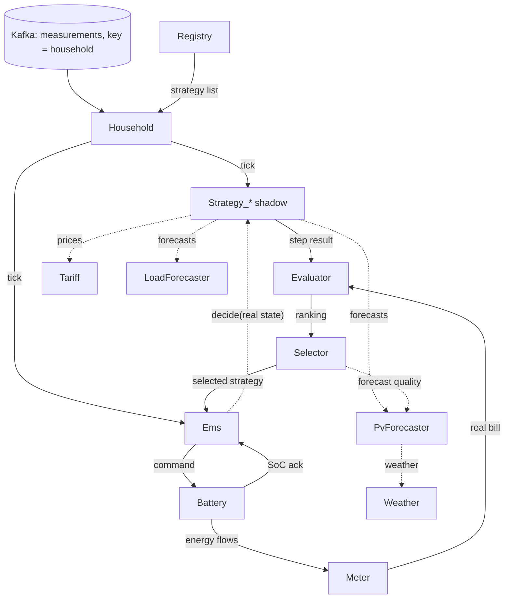

# PROJECT_CONTEXT — Counterfactual Multi-Strategy Energy Management on Durable Stateful Actors

> Bootstrap brief for Claude Code about this MSc thesis project (v2). Place it at `docs/bootstrap/PROJECT_CONTEXT.md`.
> After step 4 of §0 it is split into the canonical docs under `docs/context/` and becomes a frozen seed; from then on `docs/context/` wins.
> **OPEN** = undecided. **VERIFY** = check against official sources before pinning or relying on it.
> Last updated: October 2026.

**Kickoff prompt for the first Claude Code session:**
`Read docs/bootstrap/PROJECT_CONTEXT.md in full, then execute section 0 step by step. Stop at every checkpoint and wait for my approval.`

---

## 0. Instructions for Claude Code (read first)

You are assisting an MSc student. Bootstrap in this order and **stop for human review at every ⏸ checkpoint**. No feature code before a spec, a plan and a task list exist and have been approved.

1. Read this whole document. Report contradictions or gaps. Ask about OPEN items only when they block the current step.
2. **Environment** (§7, §8):
   - a single `uv` project at the repo root, `requires-python = ">=3.13"`, `.python-version` = `3.13`, dependency groups (§7.3),
   - ruff, ty and pytest configuration in `pyproject.toml` (§7.3),
   - `.pre-commit-config.yaml` from `templates/`,
   - the root `Makefile` from `templates/` (keep the target names; §7.2),
   - `infra/docker-compose.yml` (Restate + Kafka-compatible broker), `infra/kind-config.yaml`,
   - a lint-clean `helm/ems/` skeleton,
   - `frontend/` reserved with a README only (do not scaffold React).

   Resolve every VERIFY item you touch (versions, images, flags, admin API body) from official sources and pin exact versions, each at least two weeks old. ⏸
3. **Reference spike** (§6): unpack `restate-ems-spike.zip` into `reference/restate-ems-spike/` (reference only) and make experiments A–C run in the new environment. ⏸
4. **Canonical docs** (§9.2): split this brief into `docs/context/00`–`11`, write `docs/context/README.md` as the index, and move this file to `docs/bootstrap/`. ⏸
5. **Spec Kit** (§9.4): install the `specify` CLI at a pinned release, initialise it in place for Claude Code, and write the constitution from §10 with `/speckit.constitution`. ⏸
6. **Claude Code harness** (§9.3, §9.5–§9.10):
   - `CLAUDE.md` (under 200 lines),
   - `.claude/settings.json`,
   - `.claude/rules/*.md`,
   - the skill spine and extras,
   - subagents. ⏸
7. **ADRs** (§2): write `docs/adr/0001`–`0009`. ⏸
8. **First feature**: run `ems-plan-change` for spec 001 (§11), which drives `/speckit.specify` → `/speckit.clarify` → `/speckit.plan` → `/speckit.tasks`. Stop before `/speckit.implement`. ⏸

---

## 1. The project in one paragraph

An energy management system (EMS) for residential prosumers (PV + home battery + grid connection, Polish/EU electricity market, 15-minute market intervals), built as a system of **durable stateful actors** (Restate Virtual Objects, Python SDK).

The central idea is **real-time counterfactual evaluation**. The same live stream of measurements and prices is routed to N battery-management strategies. Each strategy runs as its own entity with its own *virtual* battery and settlement, so strategies can be compared fairly ("what would have happened if…") and can be added or replaced at runtime without restarting anything.

At any moment exactly one strategy controls the *real* battery through a closed feedback loop; a **Selector** actor decides which one, based on current conditions and on evaluation results.

The system must provide exactly-once settlement under failures and scale to hundreds of households.

---

## 2. Background and decisions (ADR candidates)

The thesis originally targeted **Apache Flink Stateful Functions (StateFun)**. StateFun is being sunset: the last release is 3.3.0 (2023-09-19) for Flink 1.16, and FLIP-569 proposes archiving the sub-project (vote outcome: VERIFY).

Alternatives evaluated: Restate, Dapr Actors, Microsoft Orleans, Apache Pekko, Ray, PyFlink, Temporal, Azure Durable Functions / Durable Task, Kalix (now Akka SDK), and Styx (a TU Delft research prototype).

| ADR | Decision | Rationale | Status |
|---|---|---|---|
| 0001 | Use **Restate** (Python SDK) as the actor runtime | Virtual Objects give per-key K/V state, a single writer per key and concurrent shared read-only handlers. Durable timers and delayed messages. Exactly-once state updates and messaging through durable execution. Also: Kafka subscriptions, deployment versioning, SQL introspection, Python SDK 1.0. The StateFun mental model carries over almost 1:1 | proposed, confirm with supervisor |
| 0002 | Fallbacks: **Dapr Actors** (same entity model, Python SDK, durable reminders, at-least-once, more infrastructure) and **Temporal** (workflow model). **PyFlink** only as a comparison baseline | The Flink DataStream iteration API was removed in 2.0, so cross-operator feedback loops need workarounds. Pekko, Orleans and Kalix have no Python SDK; Ray actors are not durable | accepted |
| 0003 | **Python ≥ 3.13** everywhere. Tooling fixed: `uv`, `ruff`, `ty`, `pytest`, `pre-commit` | One language for runtime and ML. `restate-sdk` 1.0.5 ships cp313 and cp314 wheels. `ty` is pre-1.0 (0.0.x), so pin it exactly; pyright is the fallback | accepted |
| 0004 | **Pure, runtime-agnostic domain core** (`src/ems/domain`) with thin actor adapters | Bit-exact offline reference simulation; hedge against vendor and licence risk; testability | accepted |
| 0005 | **Cycles only over one-way messages**; request-response only to shared (read-only) handlers | Request-response cycles between exclusive handlers of Virtual Objects can deadlock | accepted |
| 0006 | **Two clocks**: simulated time carried by events for replay and experiments; wall-clock durable timers only in live mode | Accelerated replay of months of data with deterministic results | accepted |
| 0007 | **Licence boundary.** The Restate server is BSL 1.1 with an Additional Use Grant. Production use invoking our own services is allowed. A managed service where third parties register their own Restate service endpoints is not. Each release converts to Apache 2.0 four years after release. External strategies therefore enter through our own API or DSL, never as directly registered Restate deployments | Keeps a future commercial path open | accepted |
| 0008 | **One repository** with subproject folders: the Python engine at the root, `helm/` and a reserved `frontend/` | A thesis needs one history, atomic changes and simple reproducibility. Split only if a subproject gets its own release cadence | accepted |
| 0009 | **Docker Compose** for the inner loop and experiments; **Helm on kind** (later a real cluster) for the deployment chapter and multi-node scale tests | Fast iteration locally, and a realistic deployment where it matters | accepted |

---

## 3. Research framing

**Agreed core directions (from the supervisor):**
1. Many strategies on one stream: real-time counterfactual evaluation; strategies added or swapped at runtime (dynamic routing).
2. Closed feedback loop: a charging decision changes the battery state, which affects the next decision and the settlement.
3. Decomposition into entities (battery/inverter, meter, forecast service, price and tariff service, EMS controller) with durable timers ("charge at 02:00", "refresh the forecast every hour").
4. Fleet scale: the same mechanisms for hundreds of households as a measurable scalability dimension.

**Student's emphasis:** actors whose state directly influences other actors, and **adaptive selection** of the controlling strategy depending on conditions (the Selector as a meta-controller).

**Draft research questions (OPEN, confirm with the supervisor):**
- **RQ1 (systems):** Can a durable stateful-actor runtime run real-time counterfactual evaluation of N strategies with exactly-once settlement under failures? How do throughput, decision latency and recovery time scale with households × strategies?
- **RQ2 (energy):** How do strategy families (rules, MILP-based MPC, ML-based) compare on cost, self-consumption, battery wear, constraint violations and robustness to forecast error?
- **RQ3 (adaptive control):** Does condition-aware selection of the live strategy beat the best single fixed strategy, and at what switching cost?

**Scope layers:**
- **Core:** mandatory, all four directions above.
- **One research contribution:** which strategies are compared (OPEN).
- **Zero or one extra:** decision explanations; robustness to noisy forecasts (the cheapest); EV or heat-pump flexibility; P2P trading.

---

## 4. Domain model

- **Time:** 15-minute market time unit, 96 steps per day. Internally UTC with an interval index `t`; display in Europe/Warsaw.
- **Units:** power kW, energy kWh, price PLN/kWh.
- **Battery (spike defaults):** capacity 10 kWh, max power 5 kW, one-way efficiency η = 0.95 for charge and discharge, SoC bounds 1.0–9.5 kWh, initial SoC 5.0 kWh.
  - Charge (p ≥ 0): `soc += p · η · Δt`. Discharge (p < 0): `soc += p / η · Δt`. Power is clamped by `p_max` and by the SoC bounds.
  - Battery wear cost: to be added (OPEN: per kWh of throughput vs. cycle counting).
- **Grid flow:** `grid = load − pv + p_batt` (> 0 import, < 0 export). Settlement per step: `cost += import_kWh · buy − export_kWh · sell`.
- **Polish net-billing:**
  - Exported energy is valued at the market price and credited to a prosumer deposit: monthly RCEm, or hourly RCE as an option since 1 July 2024.
  - The purchase price includes distribution fees and taxes, so buy ≫ sell.
  - Exact rules for the modelling year: VERIFY. The spike uses a synthetic curve with `sell = max(0, 0.6 · buy − 0.1)`.
- **Decision actions (discrete):** `CHARGE_FROM_PV`, `CHARGE_FROM_GRID(level)`, `DISCHARGE_TO_LOAD`, `EXPORT`, `HOLD`, `CURTAIL`, `SHIFT_FLEX_LOAD`. The Battery entity enforces physical limits: an infeasible command is clamped or rejected, never executed blindly.
- **Glossary:**
  - *Local state*: owned by one actor (e.g. SoC in `Battery`).
  - *Household state*: the composition of the local states of all actors under one household key. There is no stored "system state".
  - *View*: what an actor knows about others from messages it received; may be stale.
  - *Shadow strategy*: runs on a virtual battery, never touches hardware.
  - *Live strategy*: the one whose decisions drive the real battery.
  - *Oracle*: perfect-foresight MILP computed offline; an upper bound and a source of training labels.

---

## 5. Architecture

### 5.1 Actors (Restate Virtual Objects)

| Actor | Key | State | Receives | Sends |
|---|---|---|---|---|
| `Registry` | `fleet` | households, strategy list | configuration commands | strategy list → `Household` |
| `Tariff` | zone, e.g. `PL` | price curve, net-billing rules | own periodic timer | prices (shared read) |
| `Weather` | location | weather forecast | own periodic timer | forecast (shared read) |
| `PvForecaster` | household | model handle, recent errors | PV measurements, weather | forecast + quality (shared read) |
| `LoadForecaster` | household | model handle, recent errors | load measurements | forecast + quality (shared read) |
| `Household` | household | active strategies | measurements (Kafka), configuration | tick → strategies and `Ems`; measurements → forecasters |
| `Strategy_*` | household | virtual SoC, settlement, plan | tick | step result → `Evaluator`; `decide()` answer (shared) to `Ems` |
| `Evaluator` | household | KPIs per strategy and per condition | step results, real bill | ranking → `Selector` |
| `Selector` | household | live strategy, switching hysteresis | ranking, forecast quality, prices | selection → `Ems` |
| `Ems` | household | seen SoC, live strategy, scheduled commands | tick, selection, SoC acks | commands → `Battery` (including delayed ones) |
| `Battery` | household | real SoC, SoH, limits | commands | SoC ack → `Ems`; energy flows → `Meter` |
| `Meter` | household | real bill | energy flows | real bill → `Evaluator` |

Optional: `FlexLoad` (EV, heat pump), `FleetAggregator` (fleet KPIs).

### 5.2 Single writer per fact

| Fact | Only writer |
|---|---|
| Real SoC / SoH | `Battery` |
| Real bill | `Meter` |
| Virtual SoC and shadow settlement | each `Strategy_*` for its own key |
| Rankings and KPIs | `Evaluator` |
| Live-strategy choice | `Selector` |
| Scheduled commands | `Ems` |
| Active strategy list per household | `Household` (fed by the `Registry` broadcast) |
| Prices and tariff rules | `Tariff` |
| Forecasts and forecast quality | the respective `*Forecaster` |

### 5.3 Connection rules (enforced in review)

- **R1.** Every edge that can be part of a cycle is a **one-way message** (e.g. `Ems → Battery → Ems`, `Selector → Ems`).
- **R2.** Request-response **only** to shared (read-only) handlers: `Tariff.prices`, `*Forecaster.forecast`, `Strategy.decide`.
- **R3.** Every non-deterministic or external effect in a handler goes through `ctx.run` / `ctx.time` so the result is journaled. This covers HTTP APIs, model inference, solver calls and the current time.
- **R4.** Idempotent ingress: idempotency key `"<household>:<t>"`. With Kafka, record key = household id, so order is preserved per household within a partition.
- **R5.** Never sleep inside an exclusive handler (it blocks the object's queue); use delayed messages.
- **R6.** Self-rescheduling periodic jobs carry a **generation number**; stale chains stop themselves.
- **R7.** Every message carries `schema_version`, `t` and a sim timestamp; receivers check monotonicity and count violations.

### 5.4 Strategy contract

- **Domain level (pure):** `Policy.decide(state, observation) -> Action`; no I/O; deterministic.
- **Actor level:**
  - `on_tick(obs)` (exclusive): advances the virtual battery, settles and emits a step result.
  - `decide(real_state)` (shared): answers `Ems` for the real SoC.

  The same policy code runs in shadow and in live mode.

### 5.5 Two clocks

- **Sim mode** (experiments, replay): time advances with event timestamps. Scheduled actions are *virtual timers* in entity state, fired when an event with `t ≥ due` arrives. No wall-clock timers in experiment logic.
- **Live mode:** Restate durable delayed messages (`send_delay`) for "charge at 02:00" and periodic refreshes.

### 5.6 Diagram

Solid = one-way message; dotted = request-response to a shared handler.



---

## 6. Reference spike (exists; not production code)

**Setup.** Built in a sandbox (1 vCPU, 4 GB RAM; everything on one core) with restate-server 1.7.12, restate CLI 1.7.12, `restate-sdk` 1.0.5, Python 3.12, hypercorn and httpx. The spike used 3.12; the project targets ≥ 3.13. It used HTTP ingress (`/send` with `idempotency-key`) and read state through the admin SQL endpoint. **Not yet reproduced on the student's machine** → spec 001.

**Files:**
- `ems_spike/model.py`: pure domain (generator, battery, strategies, offline reference).
- `ems_spike/restate_app.py`: deployment #1.
- `ems_spike/extra_app.py`: deployment #2, adds a strategy at runtime.
- Tooling: `loadgen.py`, `experiments.py`, `rerun.py`, `ctl.sh`, `tools/killport.py`.
- Outputs and docs: `results.json`, Polish `README.md`.

| Test | Result |
|---|---|
| A: 50 households × 96 steps, 3 strategies + live loop | 4,800 events and 38,400 handler invocations in 82.2 s (~467/s). 150/150 strategy states bit-identical to the reference. 0 out-of-order. Live-loop bill equals the in-state SelfConsumption bill (50/50) |
| B: A + `kill -9` of the SDK service (1,450 events) and of the server (2,886) | 543 ingest retries; 150/150 bit-identical; no duplicates or losses; 135.7 s |
| Full-day re-send with the same idempotency keys, with kills | 0 duplicates |
| C: new strategy deployed mid-stream | No restarts; 50/50 households joined; 200/200 bit-identical |
| D: one-shot timers (6 s, 20 s) + 3 s refresh; `kill -9` of everything for 9.2 s | All fired, none lost; late by +22.8 s / +8.7 s |
| D2: as D with back-off capped at 1 s (8.9 s outage) | +28.8 s / +14.8 s. Both fired at the same moment ~18–24 s after restart, which points to a recovery phase. Cause unknown; the hypothesis is log recovery after `kill -9`, with the health endpoint answering before partitions are ready |
| E: 200 households | 19,200 events and 153,600 invocations in 314.9 s (~488/s, CPU-bound); 600/600 bit-identical |
| Generation guard | Without: two parallel refresh chains. With: one stale tick, then a single chain |

**Synthetic counterfactual result (A):** per household and day, NoBattery 6.96 PLN, SelfConsumption −0.53 PLN, PriceAware ("charge at 02:00") 2.27 PLN. The naive price rule loses to self-consumption, probably because a battery filled at night cannot absorb the midday PV surplus.

**Pitfalls:**
- hypercorn serves from a multiprocessing child: kill services **by port**.
- Without IPv6, set `RESTATE_BIND_IP=127.0.0.1`.
- `register --force` is dev-only.
- Accelerated replay makes the live loop's view stale: ~99% of decisions lacked the previous step's ack, with 23–41 s queue lag. This motivates §5.5.
- The post-restart timer delay must be measured and explained (recovery-latency metric).

---

## 7. Tech stack and environment

### 7.1 Stack

| Area | Choice | Notes |
|---|---|---|
| Language and tooling | Python ≥ 3.13; uv, ruff, ty, pytest (+ pytest-asyncio, pytest-cov), hypothesis, pre-commit | Fixed (ADR 0003). Enable ruff's `ASYNC` rules: they flag blocking calls inside `async def` |
| Configuration | `pydantic-settings` owns runtime config | No scattered `os.getenv`; fail fast on missing required settings |
| Runtime | Restate server 1.7.x, `restate-sdk` 1.0.x, hypercorn | Tested 1.7.12 / 1.0.5. Docker image tag: VERIFY |
| Broker (dev) | Kafka-compatible single node (Redpanda or Apache Kafka in KRaft mode) | VERIFY image |
| Kubernetes | Helm 3, kind locally | See §7.4 |
| Data | pandas, pyarrow, duckdb; entsoe-py, Open-Meteo, pvlib | ENTSO-E API token is requested by e-mail |
| Forecasting | LightGBM baseline; Chronos-2 (`chronos-forecasting`, known-future covariates, runs on CPU) | epftoolbox (LEAR, DNN) as the price-forecasting reference |
| Optimisation | HiGHS via `highspy` (or PuLP) | MILP/MPC, receding horizon |
| Optional ML strategy | CLM-8B (Stanford & NVIDIA, Sept 2026, Apache 2.0; frozen Qwen3-8B + ~20M head; selects from candidate actions), served e.g. with vLLM | GPU needed (OPEN); compare against a small classifier trained on the same labels |
| Results | Parquet + DuckDB, matplotlib | Each run stores config, seed, data window, hardware, git commit |
| Observability | Restate UI and SQL introspection; OpenTelemetry only if end-to-end | All-or-nothing: no partial tracing (VERIFY Restate's OTLP export) |
| CI | `make ci` is the single entry point | Platform OPEN (GitHub Actions or university GitLab) |
| Frontend (future) | Latest stable React, TypeScript, custom components on our own design tokens, no third-party component library | **Out of scope until a spec exists; do not scaffold or modify** |

### 7.2 Makefile surface (template in `templates/Makefile`)

| Target | Meaning |
|---|---|
| `install` | `uv sync --all-groups`, `pre-commit install` (+ frontend once it exists) |
| `dev` | Run the SDK services locally with reload |
| `lint` | `ruff check`, `ruff format --check`, Helm dependency check (+ frontend) |
| `format` | `ruff check --fix`, `ruff format` (+ frontend). Run at the end of every code change |
| `type-check` | `ty check` |
| `pre-commit` | All hooks on all files |
| `test-unit` | Unit and property tests (no infrastructure) |
| `test-integration` | Actor tests against a real Restate server |
| `test-e2e` | Replay tests, bit-exact against the offline reference |
| `test-fault` | `kill -9` of the SDK service / server during replay |
| `test` | unit + integration + e2e, then combined coverage |
| `report-coverage` | Combine coverage into `logs/coverage.xml` |
| `ci` | `lint` + `type-check` + `test` |
| `up` / `down` | Local infrastructure via Docker Compose |
| `register` | Register SDK services with Restate (admin API; VERIFY body) |
| `exp NAME=…` | Run `experiments/configs/<NAME>.yaml` |
| `kind-up` / `kind-down` | Local Kubernetes cluster |
| `helm-deps` / `helm-deps-check` / `helm-lint` | Chart dependencies, staleness check, lint + template |
| `deploy-local` | `helm upgrade --install` into kind |
| `clean` / `install-uv` | Housekeeping / bootstrap |

### 7.3 pyproject essentials

```toml
[project]
name = "ems"
requires-python = ">=3.13"
dependencies = ["restate-sdk==1.0.5", "hypercorn", "httpx", "pydantic-settings"]

[dependency-groups]
dev = ["pytest", "pytest-asyncio", "pytest-cov", "coverage", "hypothesis", "ruff", "ty", "pre-commit"]
data = ["pandas", "pyarrow", "duckdb", "entsoe-py", "pvlib"]
forecast = ["lightgbm", "chronos-forecasting"]
opt = ["highspy"]
# ml-gpu (optional, separate image): vllm, torch

[tool.ruff]
target-version = "py313"
line-length = 100

[tool.ruff.lint]
select = ["E", "F", "W", "I", "UP", "B", "ASYNC", "SIM", "RUF"]

[tool.pytest.ini_options]
asyncio_mode = "auto"
markers = ["unit", "property", "integration", "e2e", "fault"]
```

All versions are locked in `uv.lock`; direct pins only where behaviour depends on them (`restate-sdk`, `ty`).

### 7.4 Kubernetes and Helm

- **Umbrella chart** `helm/ems/` with dependencies on:
  - the Restate Helm chart (`oci://ghcr.io/restatedev/restate-helm`; by default a single-replica StatefulSet, replicated values for multi-node),
  - a Kafka chart or operator (Strimzi or Redpanda: VERIFY),
  - optionally MinIO.
- **SDK services:** prefer the **Restate Operator** (`RestateDeployment` CRD), which handles registration and versioning.
  - Alternative: plain Deployments plus a post-install registration Job.
  - With plain Kubernetes Services, mind the Restate docs' warning: HTTP/2 connection reuse sends all requests to one pod unless an L7 load balancer (e.g. an Envoy sidecar) is used.
- **Values files:** `values-local.yaml` (kind) and `values-cluster.yaml`.
- **Rules:** chart dependencies are locked (`Chart.lock`), and `helm-deps-check` fails when they are missing or stale.

---

## 8. Target repository layout

```
.
├── CLAUDE.md                        repo-level instructions (< 200 lines)
├── .claude/                         settings.json, rules/*.md, skills/, agents/
├── .specify/                        Spec Kit workspace (constitution in .specify/memory/)
├── specs/NNN-feature/               spec.md, plan.md, research.md, data-model.md, contracts/, tasks.md
├── docs/
│   ├── context/00-…11-*.md          canonical docs, indexed by the ems-context skill
│   ├── context/README.md            index
│   ├── adr/NNNN-title.md
│   ├── thesis/                      notes feeding thesis chapters
│   └── bootstrap/PROJECT_CONTEXT.md this brief (frozen after the split)
├── src/ems/
│   ├── domain/                      pure: battery, settlement, tariffs, actions, policy interface
│   ├── actors/                      Restate Virtual Objects (thin) + app.py (ASGI entrypoint)
│   ├── strategies/                  policies: rules, mpc, ml
│   ├── forecasting/                 LightGBM, Chronos-2 wrappers
│   ├── optimization/                MILP models, oracle
│   ├── ingest/                      Kafka producers, synthetic generator, data adapters
│   ├── sim/                         replay driver, sim clock, offline reference
│   ├── experiments/                 experiment runner (python -m ems.experiments.run)
│   └── settings.py                  pydantic-settings
├── jobs/                            batch CLIs (training, backtests, oracle): no HTTP surface
├── experiments/                     configs/, results/ (raw results gitignored)
├── tests/                           unit/, property/, integration/, e2e/, fault/
├── infra/                           docker-compose.yml, kind-config.yaml
├── helm/ems/                        umbrella chart, values-local.yaml, values-cluster.yaml
├── frontend/                        RESERVED: README only, future React UI
├── reference/restate-ems-spike/
├── templates/                       Makefile and pre-commit templates used at bootstrap
├── .pre-commit-config.yaml
├── pyproject.toml, uv.lock, .python-version
└── Makefile
```

---

## 9. Agent harness (Claude Code)

### 9.1 Orientation and precedence

Three moves before planning or writing anything:
1. **Locate:** which area owns the files (domain, actors, strategies, ingest, sim, infra, helm).
2. **Ground:** read `CLAUDE.md`, then invoke `ems-context`, which points to the relevant `docs/context/` files. Read those, not all of them.
3. **Layer:** add the surface skill (`ems-actor-contract`, `ems-experiment`, …).

**Precedence when sources disagree:** `CLAUDE.md` and `docs/context/07-design-principles.md` → other `docs/context/` files → skills → this bootstrap brief. Surface real contradictions in the answer instead of silently picking a side.

### 9.2 Canonical docs (`docs/context/`)

| File | Content |
|---|---|
| `00-overview.md` | Purpose, scope layers, repo map |
| `01-architecture.md` | Actors, ownership, diagram |
| `02-subsystem-actors.md` | Restate services, handlers, R1–R7, registration |
| `03-subsystem-strategies-and-evaluation.md` | Policy contract, shadow vs live, Evaluator, Selector |
| `04-subsystem-forecasting-and-optimization.md` | Forecasters, MILP/MPC, oracle |
| `05-deploy-and-infra.md` | Compose, kind, Helm, CI, pre-commit |
| `06-data-flows.md` | Tick, live loop, replay and sim clock, failure and recovery, timers |
| `07-design-principles.md` | Invariants (§10); every plan is checked against them |
| `08-contracts.md` | Message schemas, Kafka topics, result schemas, strategy registry, versioning rules (§9.11) |
| `09-risks-and-tech-debt.md` | Known issues with fix hints (seed from §6 pitfalls and §13) |
| `10-planning-guide.md` | How to plan: `ems-plan-change` → Spec Kit, actor-contract template, checklists |
| `11-experiments.md` | Protocol, metrics, statistics (§12) |

### 9.3 Skills (`.claude/skills/<name>/SKILL.md`)

**Spine:**

| Skill | When |
|---|---|
| `ems-context` | Every non-trivial task, first. Indexes `docs/context/` and points to the right files |
| `ems-plan-change` | Before any new actor, handler, message, contract, strategy, schedule behaviour or infra change. Runs the principle, contract and risk checklists, then drives Spec Kit to produce the artefacts |
| `ems-deploy-checklist` | Before compose, Helm, kind, CI or release work |

**Extras (start with these two only):**

| Skill | When |
|---|---|
| `ems-actor-contract` | Any change to handlers, message schemas, timers or ownership: R1–R7 and `08-contracts.md` |
| `ems-experiment` | User-invoked only (`disable-model-invocation: true`): create, run and report an experiment |

Add `ems-new-strategy`, `ems-fault-injection` and `ems-adr` only once the workflow has repeated. Skills are only discovered under `.claude/skills/`.

### 9.4 Spec Kit integration

- Install: `uv tool install specify-cli --from git+https://github.com/github/spec-kit.git@<release-tag>` (VERIFY latest; v0.11.1 was current in June 2026).
- Initialise in place: `specify init --here` with the Claude integration (`--ai claude` in older docs, `--integration claude` in newer; check `specify init --help`).
- Loop: `/speckit.constitution` (once) → `/speckit.specify` → `/speckit.clarify` → `/speckit.plan` → `/speckit.checklist` (optional) → `/speckit.tasks` → `/speckit.analyze` → `/speckit.implement`.
- `ems-plan-change` is the entry point that wraps this loop. Every `plan.md` touching actors contains an **Actor contract** section: actors, keys, state schema, exclusive/shared handlers, messages, timers, failure modes, and a check against R1–R7 and §5.2.
- Acceptance criteria use EARS style ("WHEN …, THE SYSTEM SHALL …"). Human approval between specify → plan → tasks → implement.

### 9.5 CLAUDE.md (under 200 lines)

Include:
- A three-line summary and links to `docs/context/README.md`. Do not `@`-import long docs.
- Orientation and precedence (§9.1).
- The skills table.
- The Makefile commands.
- Invariants as one-liners (§10).
- The do-not list:
  - no Restate imports in `domain/`,
  - no request-response cycles,
  - no wall-clock timers in sim mode,
  - no blocking calls in handlers,
  - no unpinned dependencies,
  - no secrets,
  - do not touch `frontend/`.
- The PR description contract (§9.9).
- "Run `make format` at the end of every code change."

### 9.6 `.claude/settings.json` (VERIFY patterns with `/permissions`)

```json
{
  "permissions": {
    "allow": [
      "Bash(make *)",
      "Bash(uv run *)",
      "Bash(uv sync *)",
      "Bash(docker compose *)",
      "Bash(helm lint *)",
      "Bash(helm template *)",
      "Bash(git status *)",
      "Bash(git diff *)",
      "Bash(git log *)"
    ],
    "deny": [
      "Bash(rm -rf *)",
      "Bash(git push --force *)",
      "Read(./.env)",
      "Read(./.env.*)"
    ]
  },
  "hooks": {
    "PostToolUse": [
      {
        "matcher": "Edit|Write",
        "hooks": [
          {
            "type": "command",
            "command": "f=$(jq -r '.tool_input.file_path'); case \"$f\" in *.py) uv run ruff format \"$f\" && uv run ruff check --fix \"$f\" ;; esac; exit 0"
          }
        ]
      }
    ]
  }
}
```

### 9.7 Rules (`.claude/rules/*.md`, Markdown with optional `paths:` frontmatter)

- `domain.md` (`src/ems/domain/**`):
  - pure functions, no I/O, no runtime imports,
  - explicit units, deterministic,
  - unit + property tests for every change.
- `actors.md` (`src/ems/actors/**`):
  - R1–R7 and single-writer ownership,
  - thin handlers,
  - async-first (offload CPU-bound or blocking work with `ctx.run` + a bounded executor),
  - versioned messages.
- `tests.md` (`tests/**`):
  - markers,
  - integration tests against a real server,
  - e2e replay with bit-exact comparison.
- `experiments.md` (`experiments/**`, `src/ems/experiments/**`):
  - config, seed and commit stored with every result,
  - results never edited by hand.
- `frontend.md` (`frontend/**`): out of scope; stop and ask before any change.

Cursor-style `.mdc` files are not loaded by Claude Code; keep rules as `.md` under `.claude/rules/`.

### 9.8 Subagents (`.claude/agents/*.md`)

- `architect-reviewer` (Read, Grep, Glob): reviews specs, plans and diffs against §10, R1–R7 and `08-contracts.md`.
- `test-engineer` (Read, Grep, Glob, Edit, Write, Bash): writes failing tests first; property tests for invariants.
- `experiment-analyst` (Read, Grep, Glob, Bash): analyses results, tables and plots; never edits `src/`.
- `energy-domain-reviewer` (Read, Grep, Glob, WebFetch): checks tariff, net-billing and battery assumptions; flags VERIFY items.

### 9.9 PR (or commit) description contract

Every change states:
- the `docs/context/*.md` files relied on,
- the design principles it touches (`07-design-principles.md`),
- known issues in scope (`09-risks-and-tech-debt.md`), each with a fix or "accepted for now",
- contract impact (message schemas, topics, result schemas: `08-contracts.md`),
- experiment impact: does any reported number change? If yes, rerun and record,
- a test plan, with at least one new test.

### 9.10 Extending the harness

- **Repo-specific rule:** a skill or rule here plus a row in `CLAUDE.md`.
- **No premature skills:** don't add a skill until a workflow has repeated.
- **Docs land in the same change:** behaviour change → update `docs/context/`; decision change → ADR.

### 9.11 Contract versioning rules (for `08-contracts.md`)

- **Messages:** every message and Kafka record carries `schema_version`. Changes within a major version are additive only.
- **Breaking changes:** renaming or removing a field means a new version (and a new topic for Kafka), an ADR, coordinated updates of all producers and consumers, and refreshed golden examples in the replay tests.
- **Initial contracts:** measurement event, tick, step result, ranking, selection, command, SoC ack, energy flows, per-step result Parquet, run summary, strategy registry entry.

### 9.12 Optional workspace level

If the thesis text lives in a second repository (e.g. LaTeX), add a short workspace-root `CLAUDE.md` that only routes: which repo owns what, and that the repo's own `CLAUDE.md` wins.

---

## 10. Design principles and constitution (for `/speckit.constitution` and `07-design-principles.md`)

1. **Spec first.** No feature code without an approved spec, plan and tasks; every change traces to a task.
2. **Pure domain, thin actors.** Domain logic is pure and deterministic; actors parse, delegate, write their own state and send messages.
3. **Single writer per fact** (§5.2).
4. **No blocking cycles.** Cycles only over one-way messages; request-response only to shared handlers (R1, R2).
5. **Async-first in handlers.** No blocking or CPU-heavy work on the event loop; journal it and offload it (R3).
6. **Exactly-once by construction.** Idempotent ingress, journaled side effects, and an automated bit-exact comparison against the offline reference for every strategy.
7. **Two clocks.** Experiments on simulated time; wall-clock timers only in live mode.
8. **Safety at the edge.** The Battery entity enforces physical limits regardless of any strategy.
9. **Contracts are versioned and additive** (§9.11).
10. **Batch jobs have no HTTP surface.** Training, backtests and the oracle are CLIs that read and write artefacts.
11. **No secrets in the repo.** Required settings fail fast; nothing defaults to a secret.
12. **Fixed, pinned tooling.** Python ≥ 3.13, uv, ruff, ty, pytest, pre-commit; `make ci` green before merge; `make format` after every change.
13. **Observability is all-or-nothing.**
14. **Reproducibility.** Every experiment stores config, seed, data window, hardware and git commit.
15. **Docs and decisions land with the change.**
16. **Measure the system, not just the energy.** Systems metrics alongside energy metrics in every experiment.

---

## 11. Initial backlog (specs in order)

| Spec | Title | Key acceptance criteria (EARS) |
|---|---|---|
| 001 | Dev environment and spike reproduction | WHEN `make install && make up` runs on a clean machine with Python 3.13, THE SYSTEM SHALL pass health checks. WHEN `make ci` runs on the skeleton, it SHALL pass. WHEN spike experiments A and C run, THE SYSTEM SHALL report 0 mismatches. WHEN experiment B runs with `kill -9` of the SDK service and the server, THE SYSTEM SHALL report 0 mismatches and 0 duplicates. Hardware, versions and timings SHALL be recorded in `docs/thesis/spike-reproduction.md` |
| 002 | Domain core | Battery model, settlement with RCEm/RCE options, action set, `Policy` interface, offline reference. Property tests: SoC within bounds; energy balance with efficiency losses; settlement additive over steps |
| 003 | Actor skeleton | `Registry`, `Tariff`, `Household`, strategy base (`on_tick` / `decide`), `Evaluator`, `Selector` (fixed choice at first), `Ems`, `Battery`, `Meter`. WHEN one day is replayed for 10 households, strategy states SHALL be bit-identical to the reference |
| 004 | Sim clock and replay driver | Virtual timers in entity state; deterministic replay at any speed |
| 005 | Kafka ingestion and synthetic generator | Seeded statistical generator calibrated on real data; Restate Kafka subscription keyed by household |
| 006 | Data adapters | ENTSO-E day-ahead (PL zone), Open-Meteo forecasts and history, PVGIS |
| 007 | Forecasting | LightGBM baseline and Chronos-2; forecast-quality metric exposed to `Selector` |
| 008 | MPC strategy and oracle | HiGHS MILP, receding horizon; perfect-foresight oracle offline |
| 009 | Adaptive Selector | Condition-aware selection with hysteresis vs. the best fixed strategy |
| 010 | Experiment harness | Scale (households × strategies), fault injection, recovery latency by phase |
| 011 | Helm deployment | Umbrella chart on kind; multi-node Restate for scale tests |
| 012 | Optional: CLM-8B strategy | Zero-shot and fine-tuned on oracle labels; small classifier as control |
| — | Frontend (not scheduled) | React UI, custom components; only after the thesis core is done |

---

## 12. Testing and experiment protocol

- **Pytest markers:**
  - `unit` and `property`: no infrastructure.
  - `integration`: real Restate server.
  - `e2e`: replay with bit-exact comparison to the offline reference.
  - `fault`: `kill -9` of the SDK service or the server.
- **Coverage:** combined across tiers into `logs/coverage.xml` by `make report-coverage`.
- **Experiment spec fields:** id, hypothesis, config (YAML), dataset and period, seeds, metrics, acceptance criteria, output location (Parquet), git commit, hardware.
- **Energy metrics:**
  - cost and savings vs. NoBattery and SelfConsumption,
  - self-consumption ratio and self-sufficiency,
  - equivalent full cycles,
  - constraint violations,
  - regret vs. the oracle.
- **Systems metrics:**
  - events/s and invocations/s,
  - decision latency p50/p99,
  - recovery latency by phase,
  - exactly-once check (bit-exact),
  - staleness of actor views.
- **Statistics:** per-household paired comparisons across households; report distributions, not only means.

---

## 13. Open decisions and risks

- **OPEN:**
  - which strategies form the research contribution,
  - GPU availability (gates CLM-8B),
  - thesis language,
  - CI platform,
  - battery wear model,
  - Kafka on Kubernetes (Strimzi vs. Redpanda),
  - Restate Operator vs. plain Deployments,
  - frontend stack details (later).
- **RISK:** the post-restart timer delay is unexplained; treat it as a measured property and investigate.
- **RISK:** Restate is a young, VC-funded project under BSL. Mitigated by ADR 0004 and ADR 0007.
- **RISK:** `ty` is pre-1.0. Pin it, and keep pyright as the fallback.
- **RISK:** single-household load forecasting is noisy. Always report a persistence baseline.
- **RISK:** sandbox scale numbers are not representative. Real scale tests need multi-core or multi-node hardware (spec 011).
- **VERIFY:**
  - FLIP-569 outcome,
  - net-billing rules for the modelling year,
  - image tags,
  - Spec Kit release and init flag,
  - Restate admin API body for `make register`,
  - OTLP export,
  - permission patterns,
  - ruff-pre-commit hook ids.

---

## 14. References

- Restate docs: https://docs.restate.dev
- Restate on Kubernetes: https://docs.restate.dev/server/deploy/kubernetes
- Restate Operator: https://github.com/restatedev/restate-operator
- Restate licence: https://github.com/restatedev/restate/blob/main/LICENSE
- FLIP-569: https://cwiki.apache.org/confluence/display/FLINK/FLIP-569:+Sunset+the+Stateful+Functions+(StateFun)+Sub-project
- Dapr actors: https://docs.dapr.io/developing-applications/building-blocks/actors/
- GitHub Spec Kit: https://github.com/github/spec-kit
- Claude Code `.claude` directory: https://code.claude.com/docs/en/claude-directory (plus the memory, skills, sub-agents, hooks and settings pages)
- ty: https://github.com/astral-sh/ty
- ruff pre-commit: https://github.com/astral-sh/ruff-pre-commit
- Chronos-2: https://arxiv.org/abs/2510.15821
- Tan et al. (NeurIPS 2024): https://arxiv.org/abs/2406.16964
- epftoolbox: https://github.com/jeslago/epftoolbox
- pvlib: https://pvlib-python.readthedocs.io
- ENTSO-E Transparency Platform: https://transparency.entsoe.eu
- Open-Meteo: https://open-meteo.com
- CityLearn: https://github.com/intelligent-environments-lab/CityLearn
