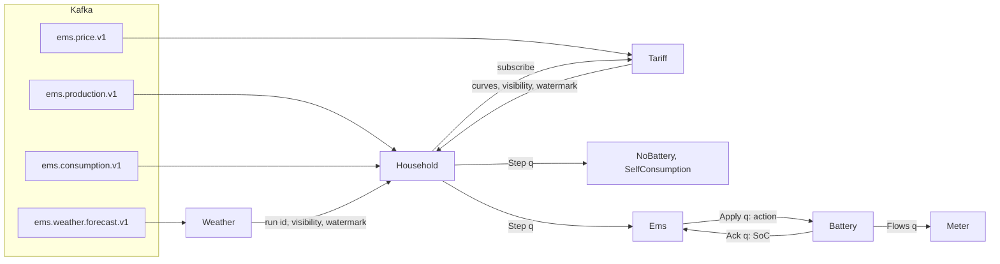

# 01 · Architecture: actors, ownership, time and ordering

## Current consensus

Designed on 2026-11-14, not built yet. The time and ordering model is ADR 0017. The actors are the minimal
skeleton of stage 3 (stages in `00-overview.md`); the domain functions they call exist since spec 009
(`12-domain-model.md`). Changes to the brief §5:
- `Tariff` is keyed by market and holds price curves only (ADR 0012, spec 009); `Weather` is keyed by location.
  Both are fed from Kafka and call no API (ADR 0011). `Tariff` pushes curves to households as one-way messages;
  no step reads another actor through a shared handler.
- Scheduled commands are data in `Ems` state, fired at their step in both modes. Durable timers remain for the
  live deadline and, later, forecaster refreshes (this narrows a consequence of ADR 0011).
- There is no `Registry`, `Evaluator`, `Selector`, forecaster or inverter actor yet. One `Battery` actor is the
  plant: mode actions model the inverter's local control (risk D6).
- `Ems` evaluates the live policy itself. `Strategy.decide` (brief §5.4) is not used: policies are pure functions
  of battery state and observation, and a call into a strategy object could read a state ahead of or behind the
  step.
- The sim clock is not a component: it is the watermark rule below.

### Actors and keys

- Every edge between actors is a one-way message. Kafka reaches the actors through the Kafka ingress
  integration (`08-contracts.md`).
- Keys are `[run_id:]location_id`; `Tariff` is `[run_id:]market_key`. `run_id` is read from the event, never
  parsed from the key (market keys contain `:`).
- Each strategy is its own Virtual Object service, keyed by household, as in the reference spike. The household
  routes by service name, so a strategy can arrive in a later deployment while the system runs.

### Single writer per fact

| Fact | Only writer |
|---|---|
| Measurements, forecasts, prices on Kafka | `ems-gen` (`13-subsystem-ingest.md`) |
| A household's step sequence: joined flows, `estimated` flags, what was visible at each step; its effective watermark per stream; its strategy list | `Household` |
| Price curves and their versions; the price stream's watermark and the visibility stamped from it | `Tariff` |
| Forecast runs; the forecast stream's watermark and the visibility stamped from it | `Weather` |
| The action commanded for the real battery at each step; the live strategy in force | `Ems` (the choice moves to the Selector, stage 6) |
| Real SoC; the battery power executed at each step | `Battery` |
| Grid energy per step, real ledger, bills and deposit | `Meter` |
| Virtual SoC, shadow ledger and bills | each strategy, for its own key |
| Per-site tariff rules, battery parameters, the RCEm table | config, through `ems.tariffs` and the site catalog (not an actor) |

### Time and ordering model (ADR 0017)

**Terms**
- `t` is the UTC quarter-hour index and `s_t` its start. `available_at` comes from `ems.contracts.availability`.
- A household has four input **streams**: production, consumption, the prices of its market (through `Tariff`)
  and the forecasts of its location (through `Weather`). A site without PV has no production stream.
- **Step `q`** covers the quarter-hour `[s_q, s_{q+1})`. From the meter streams it reads slot `q`; from prices
  and forecasts it reads the records with `available_at ≤ s_q`.
- A stream's **watermark** `W` is a promise: everything a step ending at or before `W` may read from that
  stream has arrived or has been declared missing. It only rises, and it starts with nothing covered.
- A household's **safe time** is the minimum of the watermarks of the streams it needs. The set of needed
  streams is fixed per run.
- Step `q` is released when the safe time is at or past its end (`W ≥ s_{q+1}` for every needed stream). Steps
  are released strictly in order, from the run's first step. That step is a run parameter on a UTC hour (the
  domain requires it), never the first record seen; earlier records are ignored and counted.

**How each watermark advances:** from the stream's content and schedule, never from the wall clock in sim.

| Stream | Advances when | To |
|---|---|---|
| production, consumption | a record arrives | the end of the longest unbroken run of closed slots. A slot is closed when its record is present, or when the same stream has delivered a record `L` or more slots newer |
| forecasts | a run arrives at `Weather` | that run's `available_at` plus the model's run cadence: the next run cannot be usable earlier |
| prices | the curve of a new delivery day arrives at `Tariff` | 13:00 local on that delivery day, when the next publication window opens |

- A sparse stream's watermark is the earliest moment its next record can become usable. A step that starts at
  that moment is therefore not covered until the next record arrives: after the 00:00 run (usable 02:00,
  watermark 05:00) the step starting at 05:00 waits for the 03:00 run.
- The cadence and the window opening are schedule constants, per forecast model and per market. They join the
  availability table in `ems.contracts.availability` (code, not wire contract) in stage 3, with a test of the
  generator against them. Only `PL:RCE` is defined, the market the skeleton consumes.
- A missing forecast run makes the household wait for the next one; a late run keeps its place in its key's
  order (`06-data-flows.md`, faults).

**Visibility.** A record becomes visible from `max(available_at, the stream's watermark when it arrived)`. On
schedule that is `available_at`. A record that arrives behind the watermark (a republished price day, an
unscheduled forecast run) becomes visible at the watermark, so no step that may already have run depends on it.
A step uses the newest version visible at its start, for the decision and for settlement alike.

**Late and missing measurements.** `L` (default 8 quarter-hours, the generator's `late_max`) is counted in
positions of the record's own stream, so the outcome does not depend on the other streams.

| Case | What happens |
|---|---|
| The record for slot `q` arrives before its stream is `L` slots past `q` | Used normally; the step waited for it |
| The stream reaches `q + L` without it | Step `q` runs on an estimate, flagged `estimated`. The estimate uses only earlier slots of the same stream |
| It arrives after that, while the stream is less than `2L` past `q` | It never changes a decision. It corrects the settlement of its hour, at a fixed point: just before the first step after the stream's newest slot at that moment |
| It arrives later still | Dropped and counted; the slot is already pruned |

A correction recomputes the slot's grid energy from the corrected PV and load and the battery power that was
already executed, then the settlement of that hour. The command, the executed power, the SoC and every later
decision stay as they were on the estimate. So whoever settles keeps each recent quarter's PV, load and
executed power, back to the start of the hour that holds the oldest slot still open to correction.

**Dedup and revisions.** State keeps one entry per slot (stream, `t`) from `2L` below the stream's newest slot.
An identical `event_id` is ignored. Different content for the same slot is a revision: a measurement revision is
handled like a late record, a price or forecast revision by the visibility rule.

**Between actors.** Order between different actors is not assumed. `Tariff` and `Weather` number their updates
per receiver, and the household applies them in sequence, holding back any that arrive early. Steps, commands,
acknowledgements and flows carry `t` and are applied the same way.

**Live mode.** The same rules run, with one more source: a durable wall-clock timer in each household. The
household keeps its own effective watermark per stream, the higher of the one it received and "now minus a
grace period", so a missing reading or a late publication cannot stall a live decision. A record that reaches
the household behind its effective watermark becomes visible from that watermark. In sim the timer does not
exist (P7), and the effective watermark equals the received one.

**End of a run.** No marker and no flush. Steps the rules cannot release stay unreleased, for example after a
gap in the last `L` slots of a stream. The offline side runs the same assembler over the recorded streams and
feeds the released steps to `stepper.step`, which equals `reference.run` bit for bit on whole hours (spec 009).
A run that stops mid-hour is therefore compared with an open hour in its state; `reference.run` alone would
reject it.

**Why it is deterministic.**
1. Each stream's state (dedup, closed slots, visibility, watermark) depends only on that stream's own order,
   and Restate keeps the order of one topic partition per key.
2. A step is released only when every needed watermark covers it, and it reads only records visible at its own
   start. How the streams interleave cannot change its content.
3. Everything after the household applies steps in `t` order.

The offline side applies the same rules through the same pure functions, reading each stream separately.

**Limits** (risks A1–A4 in `09-risks-and-tech-debt.md`): buffers grow with the skew between a household's
inputs, so large backfills are paced; the schedule constants are assumptions about the sources; a republished
price day is visible only at the next publication window; a live run and its replay can differ where a deadline
fired.

### State, handlers and messages

E = exclusive, S = shared (read-only).

| Actor | State | Handlers | Sends |
|---|---|---|---|
| `Household` | Run and site parameters, resolved once. Per meter stream: newest slot and the slots from `2L` below it. Price view: curves from the current local day on, with visibility, effective watermark, last sequence number, held-back updates. Forecast view: run ids with visibility, effective watermark, sequence number. Next step, pending corrections, counters | `on_measurement` (E, Kafka: production and consumption) · `on_prices` (E, from Tariff) · `on_forecast` (E, from Weather) · `status` (S) · stage 4: `on_deadline` (E, live timer), `set_strategies` (E, control) | `Tariff.subscribe` on first use · `on_step` of each strategy · `Ems.on_step` |
| `Tariff` | The run's curves by delivery day with versions and visibility, watermark, subscribers with their sequence numbers | `on_price` (E, Kafka) · `subscribe` (E, from Household) · `status` (S) | `Household.on_prices`: a snapshot on subscribe, then one update per accepted publication |
| `Weather` | Per run: issue time, model, `event_id` and visibility, for the slots still open to dedup; watermark, sequence number. No forecast payload in stage 3 (stage 5 decides storage and retention) | `on_forecast` (E, Kafka) · `status` (S) | `Household.on_forecast`: issue time, visibility and watermark, no payload |
| `NoBattery`, `SelfConsumption` | The stepper state (virtual SoC, last flows, open hour, the open month's rows, deposit tranches), the recent quarters kept for corrections, closed months, next step, held-back steps | `on_step` (E, from Household) · `summary` (S) | nothing in stage 3 |
| `Ems` | Live strategy name, its view of the real SoC tagged with `t`, the previous step's flows (for the observation), steps waiting for the previous acknowledgement, next step | `on_step` (E, from Household) · `on_ack` (E, from Battery) · `status` (S) | `Battery.apply` |
| `Battery` | Real SoC, parameters, last step, clamp counters | `apply` (E, from Ems) · `state` (S) | `Ems.on_ack` · `Meter.on_flows` |
| `Meter` | The settlement state (open hour, month rows, tranches), the recent quarters kept for corrections (PV, load, executed power), closed months, next step | `on_flows` (E, from Battery) · `bill` (S) | nothing |

Internal Restate messages (not wire contract; each carries `schema_version`, `t` and the sim timestamp):

| Message | From, to | Content |
|---|---|---|
| `Step` | Household to each strategy and to Ems | `QuarterIn` of spec 009 (`t`, PV and load energy, the RCE visible at `s_t`), the `estimated` flags, the issue time of the newest forecast run visible at `s_t`, and any corrections due |
| `PriceUpdate` | Tariff to Household | Sequence number, curves with their visibility, the watermark |
| `ForecastUpdate` | Weather to Household | Sequence number, the run's issue time and visibility, the watermark |
| `Subscribe` | Household to Tariff | The household key and its first step |
| `Apply` | Ems to Battery | The `Action`, the step's flows and price, corrections |
| `Ack` | Battery to Ems | `t` and the SoC after it |
| `Flows` | Battery to Meter | PV, load and the executed battery power of `t`, its price, corrections. `Meter` derives the grid energy with the domain function the reference uses |

- **The real loop.** `Ems` holds the real SoC from the last acknowledgement and waits for acknowledgement `t−1`
  before deciding `t`. `Battery` resolves the action against the step's flows, clamps it (P8) and reports the new
  SoC. With SelfConsumption live, the real SoC and bill equal that strategy's virtual ones (parity check).
- **Corrections travel inside the next `Step`** and on through `Apply` and `Flows`, so they never overtake the
  step they correct.
- **A site the EMS does not manage** keeps a counter and nothing else, in `Household` and in `Weather` alike;
  its records still reach those objects, because the topics carry every site.
- **Run and site parameters** (the run's first step, tariff, battery, strategy list, `L`, the RCEm table) are
  resolved once per object and kept in its state, so a config edit or a later deployment cannot change a
  running household (P14). How the actor service obtains them is decided in stage 3.
- **The `estimated` flag** marks the household's own estimate for a missing reading. It is not the wire
  `quality` of a reading.
- **The RCEm table is a run parameter** read as config, as `reference.run` and `stepper.step` take it: PSE values
  for real-data runs, a proxy table computed before the run for synthetic runs (it needs whole months). A site
  whose months are missing from it fails fast.
- **Cost:** 6 invocations per household-step plus one per strategy; 8 with two strategies.

### How R1–R7 hold

| Rule | How it holds |
|---|---|
| R1, R2 no blocking cycles | Every edge between actors is one-way, including both cycles (Household to Tariff and back; Ems to Battery and back). Request-response is used only from outside (tests, the export CLI) to shared handlers |
| R3 journal non-determinism | Handlers make no external calls. Site parameters are resolved once and stored in state. The wall clock appears only in the live deadline handler, through `ctx.time()` |
| R4 idempotent ingress | Three kinds of duplicate, each caught where it arises. A Kafka record redelivered after a restart or rebalance: Restate deduplicates by consumer group, topic, partition and offset. Messages a handler sends: Restate deduplicates them across retries of that execution, so they need no idempotency key. The same event published twice: the slot table drops the second by `event_id`. No idempotency key is taken from records: the slot table is needed anyway for the join, late records and revisions. Control calls through HTTP ingress carry an `Idempotency-Key` |
| R5 never wait in an exclusive handler | Waiting means buffering in state until a watermark passes. Live deadlines are delayed self-messages |
| R6 generations | The live deadline timer is the only self-rescheduling chain; it carries a generation number. Sim has none |
| R7 envelope | Every message carries `schema_version`, `t` and the sim timestamp. Receivers apply messages in `t` or sequence order, hold back early ones, and count every reordering |

### Restate facts

docs.restate.dev is not versioned: each statement was read in the current docs on the date given, and stage 2
confirms the behaviour on the pinned versions (`05-deploy-and-infra.md`).

| Fact | Checked |
|---|---|
| At most one handler with write access runs at a time per object key; shared handlers run concurrently | 2026-11-14, <https://docs.restate.dev/concepts/services> |
| Kafka ingress integration: "requires Restate v1.8.1 or later"; records reach a Virtual Object's exclusive handler "in the order in which they arrived on the topic partition"; the record key becomes the object key and the value the JSON payload; one container can consume several topics into one handler; the handler sees `kafka.topic`, `kafka.partition`, `kafka.offset`, `kafka.timestamp` | 2026-11-14, <https://docs.restate.dev/services/integrations/kafka> |
| Exactly-once from Kafka: "Restate deduplicates based on consumer group id, topic, partition and offset" | 2026-11-14, same page |
| Calls and sends made during one handler execution are deduplicated automatically; independent callers need an idempotency key. "Calls to a Virtual Object execute in order of arrival, serially"; other invocations may interleave between two sends | 2026-11-14, <https://docs.restate.dev/develop/go/service-communication> (the Python page says the same) |
| The in-server Kafka subscriptions are "the old Kafka support which we plan to remove in future releases"; not used | 2026-11-14, <https://docs.restate.dev/services/invocation/kafka> |
| Nothing is documented about order or relative speed across topics or partitions, or about the order of messages between two objects across separate invocations; the model assumes none | 2026-11-14 |
| HTTP ingress: `Idempotency-Key` header, result kept 24 h; one-way sends and delays | 2026-11-14, <https://docs.restate.dev/services/invocation/http> |
| Delayed sends are durable; a sleep in an exclusive handler blocks its key; state is sent with every invocation unless lazy state is enabled | 2026-10-30, <https://docs.restate.dev/develop/python/durable-timers>, <https://docs.restate.dev/develop/python/state> |

## What to build

One spec per stage, each planned in its own conversation with `ems-plan-change`. The stage table (scope and
"done when") is in `00-overview.md`; the briefs below are the handoff. A stage that finishes refreshes the next
brief.

### Stage 2 · Restate environment and Kafka into a Virtual Object

- **Read first:** this doc (model, Restate facts, VERIFY list), `05-deploy-and-infra.md`, `08-contracts.md`
  (topics, keys, handoff), `09-risks-and-tech-debt.md` (K6, A5), `11-experiments.md`, brief §6 (the spike and
  experiments A–C).
- **Already decided:** Restate 1.8.1-hotfix.2. Kafka reaches Restate only through the Kafka ingress integration,
  one container per target handler (meters, forecasts, prices); nothing is built on the in-server
  subscriptions and no fallback is kept. One Kafka broker. Pins by exact tag and digest (P12). If V1 or V2
  fails, the stage stops and the way forward (a newer release, an upstream report) is re-planned through an
  ADR.
- **This stage decides:**
  - the `restate-sdk` and `hypercorn` pins;
  - whether Kafka-fed handlers take raw bytes (V3);
  - the ingress containers' restart policy and memory limits;
  - the spike: it sits untracked at `restate-ems-spike/` (with a virtualenv and logs). The stage moves it to
    `reference/restate-ems-spike/`, chooses the files to track, and says what counts as reproducing A–C if the
    spike's own pins (server 1.7.12, SDK 1.0.5) cannot run unedited on the stage's server;
  - where the probe object lives and whether stage 3 removes it;
  - the definition of the skew between topics and where it is recorded (`docs/thesis/` does not exist yet).
- **VERIFY items it owns:** V1–V4, V7–V11.
- **Docs it writes:** the registration and Kafka ingress part of `02-subsystem-actors.md`; the pins in
  `05-deploy-and-infra.md`; the resolved VERIFY items here; the stage 3 brief.
- **Done when:** the stage table's criteria hold: a healthy stack, idempotent registration, a probe object that
  sees each key's records in partition order with none lost or doubled after `kill -9` of the server, the SDK
  service or an ingress container, the measured skew between topics recorded for the thesis, spike A and C with
  0 mismatches and B with 0 duplicates.
- **Start with:** "Plan stage 2 from its brief in `docs/context/01-architecture.md`."

### Stage 3 · Actor skeleton

- **Read first:** this doc, ADR 0017, `12-domain-model.md` (actions, `Policy`, stepper, reference, the notes for
  the actor stages), `08-contracts.md` (handoff, availability), `06-data-flows.md` (emission schedule, faults),
  `specs/009-domain-core/`, the stage 2 results. Where the actor notes in `specs/009-domain-core/plan.md` differ
  (shared price reads, live RCEm on `Tariff`), this doc and `12-domain-model.md` win.
- **Already decided:** the ordering model; the actors, edges and messages above; `L` = 8 by default; the
  household gates on forecasts and records the visible run per step; `Ems` evaluates the live policy; the first
  step and the RCEm table are run parameters and the tests use RCE sites; results are read from state.
- **This stage decides** (each is OPEN until then):
  - how a correction reaches the ledger. Either the hour row is recomputed, and a correction that lands after
    its month closed is dropped and counted; or each quarter is settled only once it can no longer change, so
    the month closes `2L` later and nothing is dropped. They differ only for readings late across a month
    boundary. Both need a domain addition, because `settle_quarter` and `stepper.step` close an hour on its
    fourth quarter and reject an out-of-order `t`;
  - the estimate for a missing reading (from earlier slots of its own stream only);
  - a split of `reference.quarter` into its decide and apply halves, so `Ems` and `Battery` run the same code
    as the reference;
  - how the actor service obtains a run's parameters (first step, site parameters, strategy list, RCEm table);
  - the rule for a quarter-hour with no visible price, which also covers a republished price day (risk A3);
  - the delay used for a `forecast_model` missing from the availability table (open in `08-contracts.md`);
  - the schemas of the internal messages (`08-contracts.md`).
- **VERIFY item it owns:** V5 (the reorder counter measures it).
- **Docs it writes:** the handlers part of `02-subsystem-actors.md`; the internal messages in `08-contracts.md`;
  the correction and the estimate in `12-domain-model.md`; `06-data-flows.md`; the stage 4 brief.
- **Done when:** 10 households × 1 day replayed through Kafka give strategy and `Meter` state equal to the
  offline side with `==`. The result is the same when the topics are published in different orders, with
  `--faults` at the default `L`, and with `--faults` at an `L` below the generator's `late_max` (for example
  2), which is the run that produces corrections and drops. The parity check holds in each run. Unmanaged
  sites keep O(1) state. Property tests show that any interleaving of the per-stream orders gives identical
  steps.
- **Start with:** "Plan stage 3 from its brief in `docs/context/01-architecture.md`."

### Stage 4 · Clocks and systems experiments

- **Read first:** this doc, `11-experiments.md`, `06-data-flows.md`, risks A1–A5, the stage 3 spec.
- **Already decided:** live mode adds one durable wall-clock deadline timer per household, with a generation
  number (R6); a strategy is added by a control message through HTTP ingress with an `Idempotency-Key` and an
  effective step `t0`; results are exported from state by a batch CLI (spec 006).
- **This stage decides:** the grace period and catch-up of the live timer; what happens to a strategy change
  that arrives after `t0` (flagged, never silent); the experiment runner (`make exp`), how the export reads
  state and where systems metrics come from (open in `11-experiments.md`); pacing a history replay; the
  builder of the proxy RCEm table.
- **VERIFY items it owns:** none new; it re-runs V10 at scale.
- **Docs it writes:** `11-experiments.md` (runner, export, metrics), `06-data-flows.md` (live clock), the
  stage 5 brief.
- **Done when:** results stay identical under `kill -9` of the SDK service and the server; recovery latency by
  phase, sustained speed, events per second and decision latency are reported (P16); a strategy added from `t0`
  joins every household without a restart.
- **Start with:** "Plan stage 4 from its brief in `docs/context/01-architecture.md`."

### Stage 5 · Strategies and forecasts

- **Read first:** this doc, `12-domain-model.md` (price signal and its gaps), `11-experiments.md`, the brief
  §7 (forecasting and optimisation stack).
- **Already decided:** a policy sees only what was visible at the start of its step; a forecast run is
  immutable and identified by its issue time; each `Step` already names the run visible at its start.
- **This stage decides:** how a run's payload reaches a policy, and how long it is kept. Retention must follow
  the reader's progress, not the forecast stream's, or a household that lags would find its run gone (the
  payload travels with the update, or the household reports its released step). Also: whether `Ems` can still
  evaluate a policy with plans in process; the price rules, the MPC and its oracle, the forecasters and their
  persistence baseline.
- **VERIFY item it owns:** V6, if runs are read through a shared handler.
- **Docs it writes:** `03-subsystem-strategies-and-evaluation.md`, `04-subsystem-forecasting-and-optimization.md`,
  the stage 6 brief.
- **Done when:** per-strategy results against the offline reference, with the cost metric of
  `11-experiments.md`.
- **Start with:** "Plan stage 5 from its brief in `docs/context/01-architecture.md`."

### Stage 6 · Adaptive Selector

- **Read first:** this doc, the brief §3 (RQ3) and §5 (Evaluator, Selector), the stage 5 results.
- **Already decided:** `Ems` owns the live strategy in force; the Selector will own the choice.
- **This stage decides:** the Evaluator and Selector actors, the switching rule and its hysteresis, the step
  from which a selection takes effect, and how `Ems` reaches a strategy added at run time (a redeploy of `Ems`,
  or a stateless service call that reads no state).
- **Docs it writes:** `03-subsystem-strategies-and-evaluation.md` (Evaluator, Selector), the ownership table
  here.
- **Done when:** the Selector is compared with the best fixed strategy (RQ3).
- **Start with:** "Plan stage 6 from its brief in `docs/context/01-architecture.md`."

## Prerequisites

- The domain core (spec 009) and the data pipeline (specs 001–008).

## Open questions

VERIFY on the pinned versions (stage in brackets):

| # | Item | Why it matters |
|---|---|---|
| V1 (2) | Per-key order from one partition holds through the integration, also across a restart of the server, the SDK service and the ingress container | The model's only ordering assumption; documented, confirmed by test |
| V2 (2) | What the integration does when the handler fails, the payload is invalid, or Restate is down; the docs do not say, and it exits after repeated failed reconnects | Restart policy; whether a bad record can block a partition |
| V3 (2) | What the SDK does when a handler's input cannot be deserialised | Whether Kafka-fed handlers must take raw bytes |
| V4 (2) | Pinning the integration image: the docs show only the `latest` tag | P12 needs an exact tag and digest |
| V5 (3) | Order of one-way messages between the same two objects across invocations | Undocumented; not relied on; the reorder counter measures it |
| V6 (5) | State written before a send is visible to a shared read triggered by that message | Undocumented; matters for forecast reads |
| V7 (2) | Cost of state shipped with every invocation; the lazy-state option of the pinned SDK | Buffer limits (risk A1) |
| V8 (2) | Whether Kafka ingestion slows down when handlers fall behind | Where a backlog lives |
| V9 (2) | The unit of `ctx.time()`; SDK and server compatibility for the chosen pins; memory of three JVM ingress containers beside Kafka and Restate | Live timers; the pins; Docker Desktop's memory |
| V10 (2) | The server restarts cleanly after `kill -9` with VQueues on (risk A5) | The fault experiments |
| V11 (2) | The integration's Kafka client works against broker 4.3.1 (ADR 0010 checked Restate's bundled client, which is no longer used) | The ingestion path |

- OPEN (stage 3): how a correction reaches the ledger, the estimate for a missing reading, how the actor service
  obtains a run's parameters, the rule for a quarter-hour with no visible price. Details in the stage 3 brief.
- OPEN (stage 5): how forecast payloads reach a policy and how long they are kept.
- OPEN: delivering a newly published RCEm to running actors in live mode. It needs a new event, which is wire
  contract (ADR 0016); no stage owns it yet.
- OPEN: exact replay of a live run needs a per-step record of what was visible (risk A4).
- `02`–`04` (actor handlers in full, strategies and evaluation, forecasting and optimisation) are written with
  the stages that build them.
