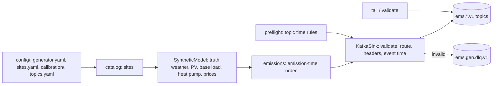

# 13 · Subsystem: ingest (data generators → Kafka)

## Current consensus

`ems-gen` (`src/ems/ingest/`) streams contract events (`08-contracts.md`) for Polish sites to Kafka. External
data reaches the EMS only through these topics (ADR 0011). Built: synthetic data for EMS-managed households (spec 001) and
live sources, record/replay and hybrid mode (spec 002), scale, background batteries and faults (spec
003), EV chargers and site types (spec 004), narrowed to PV prosumer sites (spec 005). Kafka runs as one broker
(spec 006 removed spec 004's 3-broker profile). Spec 007 made the statistics fit for comparing strategies: run-
consistent forecast errors with timing errors, persistent base load with appliance peaks, and hybrid truth that
deviates from the live forecasts.

### Layout

| Module | Role |
|---|---|
| `contracts/` | envelope and payload models, ids, time, topic plans and routing, schema export (importable by actors) |
| `ingest/catalog/` | site models, voivodeship table, deterministic catalog, `config/sites.yaml` overrides |
| `ingest/rng.py` | counter-based randomness keyed by (seed, location, variable, step) |
| `ingest/synthetic/` | `solar` (pvlib SPA numpy + Ineichen), `weather` (truth and forecasts), `truth` (truth-source seam), `pv`, `load` (BDEW H25/G25, noise, impulses), `heat_pump`, `ev`, `bess`, `balance`, `prices` |
| `ingest/generator.py` | chunks, event builders, emission schedule |
| `ingest/runner.py` | preflight, pacing per clock mode, run manifest |
| `ingest/kafka/` | client config, admin (ensure), sink, preflight |
| `ingest/tools/` | bounded topic reader, validate |

### Synthetic models (calibration in `config/calibration/*.yaml`)

- **Determinism**: every value is a function of (seed, location, variable, quarter index). Hash-based uniforms
  make a location's output independent of batch size and order (AC-001-26, bit-exact); AR(1) noise is a per-row
  recursion with a 6-time-constant burn-in, so values barely depend on the window start.
- **Weather truth**: a national hourly regime chain (clear / broken / overcast, monthly probabilities) shared by
  all sites, plus regional and local AR noise, gives the clear-sky index; GHI = Ineichen clear-sky × index
  (≤ 1.1 × clear-sky); Erbs split into DNI/DHI. Temperature: seasonal and diurnal harmonics, continentality,
  lapse rate, national synoptic and local anomalies. Wind: Gaussian AR copula (national share 0.8) → Weibull at
  10 m, power-law shear to 100/120 m, direction as a mean-reverting walk.
- **Truth source** (`synthetic/truth.py`, spec 007): the one place that decides where a site's truth weather
  comes from. `SyntheticModel(truth_source=…)` calls a `TruthSource(sites, axis) -> Truth`; PV, heat pump and base
  load read weather only from that `Truth`. `SyntheticTruth` is the synthetic weather above; `LiveForecastTruth`
  serves hybrid live sites (below). A historical backfill adds a source (satellite or reanalysis arrays) without
  touching the asset models.
- **Forecasts** (spec 007): runs every 3 h, 192 steps, emitted 90 min after issue. For variable x, valid time v and
  run r with lead L = (k + 1)·0.25 h, `err_x = sd_x(L)·(ρ·Z_x(v) + √(1−ρ²)·Y_x(r, v))`: Z is an AR(1) over valid
  time shared by every run (τ 2 h), Y an AR(1) along one run's steps, ρ = 0.9, so consecutive runs' errors for one
  valid time correlate at about ρ² and agree in sign. The clear-sky index error acts in a bounded logit space
  (`logit((kt − 0.03)/1.07)`, sd 0.95 + 0.002·L), so kt stays inside (0.03, 1.1) without clipping and errors are
  smaller under clear or overcast skies; temperature is additive (1.3 + 0.015·L K), wind speed a mean-one
  log-normal factor (0.34 + 0.0035·L, all heights). A timing error moves the clear-sky index only (clear-sky GHI
  stays, so day and night stay in place): δ is drawn at knots (0 at the issue time, then every 12 h of valid time,
  sd 0.42·√L h, the same shared-plus-per-run mix with ρ_φ 0.95), clipped to [−min(L, 6 h), 6 h] and interpolated
  linearly, so the time warp is monotone and never samples before the issue time. The truth axis extends past the
  last run by the 6 h cap at its end only (causal processes: meters do not change). Checked on 64 days × 3 seeds
  × 4 seasons: daylight kt error sd about 0.19 at 0–6 h → 0.24–0.27 at 42–48 h (hourly NWP verification: about
  0.20 → 0.23, timing included), consecutive-run correlation ≥ 0.75. Parameters and sources (VERIFY where no
  value is published): `config/calibration/weather.yaml`, `specs/007-realistic-generator-data/plan.md` §5.
- **PV**: pvlib Hay-Davies POA, Faiman cell temperature, PVWatts DC (`effective_irradiance=`) and inverter
  clipping at the AC rating, seasonal soiling/snow derate. One simulated year for the test site: 932 kWh/kWp
  (PVGIS central Poland about 930; measured PL rooftops 869–1076).
- **Base load**: demandlib 0.2.2 BDEW 2025 H25 (G11/G12) and G25 (C11/C21) on a tz-aware Europe/Warsaw index
  with Polish holidays, renormalised to an exact annual sum. Official Polish DSO profiles exist only as yearly PDF
  annexes in each DSO's IRiESD with no reuse terms, so BDEW is the default. Spec 007
  (`config/calibration/load.yaml`): `E = A·(1−s)·shape·D(day)·exp(σ·X − σ²/2) + I`, with D a mean-one lognormal
  per site and Europe/Warsaw delivery day (92/100-slot days included), X two-timescale noise
  (`√(1−w)·X_fast + √w·X_slow`, unit AR(1)s; H25: τ_fast 0.66 h, τ_slow 3 h fixed, w 0.44, σ 0.45, daily sd 0.01,
  fitted on WPuQ 2019; G25 a single AR(1), τ 1.5 h, VERIFY) and I appliance impulses for H25 households: kettle 2.0 kW × 3 min, oven
  2.1 kW × 27 min, washing-machine heater 2.0 kW × 20 min (CREST, UK HES, EEA, GUS ownership; Polish rates VERIFY),
  spread over the quarter-hours they overlap (a kettle adds 0.1 kWh to its quarter). Rates are per reference
  household (2,300 kWh/yr) and scale with the site's energy; starts follow the profile share, so the expected
  annual energy stays A and s ≈ 0.17. G25 sites get noise but no impulses. Parsing fails fast if s > 0.4 or a
  start probability exceeds 1. Impulses that start before a window are drawn too, so window splits are exact.
- **Heat pump**: degree-hour space heating (base 15 °C, heating curve) and hot water over a Carnot-fraction COP;
  the test site uses about 3.7 MWh/yr.
- **Prices (PL_RCE-like)**: monthly base, daily shape with morning and evening peaks, weekend/holiday factor,
  national PV index dip (negative middays in spring/summer), wind index, AR noise and rare evening spikes; one
  simulated year gives 3.3 % negative quarter-hours. Published D−1 13:00–16:15 local (77 % 13–14 h).
- **Batteries**: sites declare `bess.control: ems | site`. EMS-managed sites (incl. the test site) emit no
  battery or grid measurements (ADR 0014); unmanaged sites emit grid import/export closing the balance.

### Clock modes

`backfill` (as fast as possible; simulated time only), `accelerated` (`--speed`, default 96), `realtime` (start
now, wall-clock pacing). Wall time is used only for pacing and `ingested_at`.

### Facts owned (single writer)

`ems-gen` is the only writer of the external inputs: weather forecasts, metered production/consumption of
uncontrolled assets, and prices. These rows move into `01-architecture.md` when the actor spec writes it.

### Live sources, routing, record and replay (spec 002)

- **Mapping engine** (`ingest/mapping/engine.py`, `mappings/*.yaml`, schema `mappings/_schema/`): raw payload →
  canonical rows (rows or column layouts, dotted paths or JSON pointers whose segments may contain dots,
  time zones and labels, units, transforms, sign split, null policy, quality map). Adapters build events from rows.
- **PSE** (`live/pse.py`; `pse.rce.v2`, `pse.csdac.v2`): one event per report and business day once every
  local-day slot is there; `issued_at` = PSE publication time (revisions → new events); `nextLink` paging;
  polls D+1 13:00–18:00 local every 15 min, then hourly, and re-polls D for revisions.
- **Open-Meteo** (`live/openmeteo.py`; `openmeteo.forecast.v1`): explicit model per site (ICON-D2 inside
  43.18–58.08 N / 3.94 W–20.34 E, DMI HARMONIE elsewhere), run time from `/data/<model>/static/meta.json`
  (used ≥ 10 min after availability), run-anchored 192-step window, truncated before the first step with a
  missing value; free API by default, customer API with the key in an `X-Api-Key` header.
- **ENTSO-E A44** (`live/entsoe.py`; off until `EMS_ENTSOE_TOKEN` and `live.entsoe.enabled`): hardened lxml
  parsing by local name, contract type A01, A03 forward-fill to the period end, native resolution (PT60M before
  2025-10-01), identical duplicate series collapse, conflicting ones are logged and not emitted, token in the
  `SECURITY_TOKEN` header, 10-minute back-off on 429. Run against the real API on 2026-10-29
  (<https://web-api.tp.entsoe.eu/api>, document type A44, zone `10YPL-AREA-----S`): token and header accepted;
  2025-09-30 returned `PT1H` × 24 slots in EUR, 2025-10-26 returned `PT15M` × 100 slots, and the current and next
  delivery day returned `PT15M` × 96 slots (tomorrow was already published in the early afternoon). A recording of
  these responses (`make record`, raw XML in `data/recordings/<name>/raw/entsoe/`, never commit it) resolved the
  VERIFY items: schema version 7:3, a single `TimeSeries` with the same elements and order as the hand-written
  fixtures, `curveType` A03 with all 96 positions present (so the forward-fill path is exercised by fixtures
  only), `createdDateTime` equal to the request time (no publication time, as risk L4 assumed). The EUR prices
  match PSE's `csdac-pln` slot for slot with a constant PLN/EUR ratio (≈ 4.4 on 2026-10-29 and 2026-10-30).
- **HTTP** (`live/http.py`): retries with jitter on 429/5xx/timeouts only; secrets scrubbed from URLs, errors
  and recordings.
- **Router and hybrid** (`sources/router.py`, `sources/live_runner.py`, `runner.run_hybrid`): per-stream modes
  from the generator config; live weather for `live.locations`, synthetic for the rest, one price source. A live
  site's synthetic PV and heat pump use `LiveForecastTruth` (spec 007, risk L5): the latest live step minus the
  synthetic forecast error at that step's lead, in the same spaces as the synthetic forecasts (bounded logit kt,
  additive temperature, mean-one log-normal wind at every height), with DNI/DHI re-split from the truth GHI. The
  published forecasts stay exactly as fetched, so a forecast-driven strategy is no longer an oracle. Intervals
  without a step (no run yet, a truncated run, past the horizon) use the synthetic truth. `live_meters` builds the
  source from a snapshot of the latest events, so the same event and seed always give the same meters. The truth
  kt jumps by about 0.12 when a new run arrives (the per-run part changes), and in logit space it regresses mildly
  toward mid kt. `config/generator.live.yaml` + `make gen-live` run it.
- **Record and replay** (`sources/recording.py`): `ems-gen record --name N` stores raw responses (redacted),
  events (`events.jsonl`) and a manifest in `data/recordings/N/`; `ems-gen replay --name N` re-publishes them
  with their ids, marked `replay:<source>`.
- **Calibration** (`ingest/calibration.py`, `jobs/calibrate.py`): price and temperature fits → candidate files in
  `config/calibration/candidates/` (review before adopting). Example: ERA5 2024 at Poznań gives an annual mean of
  11.5 °C (a record-warm year; the default 8.7 °C is the 1991–2020 normal).
- **Load calibration** (spec 007, `jobs/calibrate.py load PATH… --format csv|wpuq`): fits the H25 noise
  (τ_fast, slow share w, σ, daily sd; τ_slow fixed at 3 h). Input is per-household quarter-hour base-load energy
  (heat pump and EV excluded): either a CSV with header `timestamp_utc,household_id,kwh` (`timestamp_utc` = interval
  start, RFC 3339 UTC `Z`; any source, for example a permitted Polish extract) or the WPuQ 15-minute HDF5 files
  (read with h5py: `NO_PV/SFH<n>/HOUSEHOLD/table`, `P_TOT` W → kWh × 0.25/1000; stamps verified as UTC interval
  starts; PV houses and the authors' list of houses missing a month skipped).
  - One estimator, `household_stats`, measures the **full load** (noise and appliance peaks alike) in data and
    model: drop holidays (PL, DE-NI) and linearly interpolated runs; r = log(E/(A·shape)) minus the household's own
    profile (quarter of day × weekday/weekend, not modelled; its sd is reported) and each local day's median; then
    the within-day ACF at 15 min, 30 min, 1 h, 2 h, the within-day sd and the day-to-day sd.
  - The noise is fitted jointly with the impulses held at their literature rates (fitting the noise alone and then
    adding impulses left the full-load ACF about 0.1 below the data at 15–30 min). A fixed point on the statistics
    removes the estimator's bias: model households with the same timestamps, gaps and energies, iterated until
    their statistics match the data's.
  - τ_slow is fixed, not fitted: free, it runs to any bound and overstates day-to-day variability (full-load day sd
    0.192 at 6 h, 0.165 at 3 h, 0.158 at 2 h vs the data's 0.150).
  - WPuQ 2019 result (27 houses): full-load ACF 0.603 / 0.345 / 0.184 / 0.094 (data) vs 0.587 / 0.343 / 0.196 /
    0.082 (model), within-day sd 0.541 vs 0.540, day-to-day sd 0.150 vs 0.165; recorded in `load.yaml`
    (`calibration_targets`). Impulse rates are not fitted (the WPuQ peak rate counts the German appliance mix: 2.1
    peaks/day vs the model's 1.7); it is a diagnostic.
  - Data: WPuQ dataset, Schlemminger et al. 2022, Sci. Data 9:56 (Zenodo 5642902), CC BY 4.0, German single-family
    houses (2019); Polish applicability VERIFY. Downloaded to `data/external/wpuq/` (gitignored), never committed.
    pvmonitor.pl (Polish PV, consumption and heat-pump dashboards) has no API, export or reuse terms (checked
    2026-11-10) and is not used without the operator's written permission.

Attribution: Open-Meteo data is CC BY 4.0 (NOTICE next to fixtures; "Weather data by Open-Meteo.com"); ENTSO-E
day-ahead prices are not open data, so only hand-written fixtures are committed; PSE data is kept only as a few
test fixtures.

### Scale, background batteries, faults, stats (spec 003)

- **Fleets**: `scale.synthetic_locations` sites, processed in slices of `scale.site_chunk` (default 2,000);
  slicing never changes a value (row-wise maths). Batteries and cumulative registers carry their state
  across consecutive chunks of a run.
- **Background batteries**: `scale.site_controlled_bess_share` of generated batteries are `control: site`
  (a separate hash decides, so the share never changes other catalog draws). Their rule policy (PV surplus,
  cheapest 4 night slots, evening 17–21 local and top-10 % prices) drives the pure domain battery
  (`src/ems/domain/battery.py`); events carry `bess` charge (consumption), discharge (production), an instant
  SoC reading (quantity `soc`, direction `charge`) and grid flows that close the balance.
- **Faults** (`ingest/faults.py`, `faults:` in `generator.yaml`, `ems-gen run --faults`): missing, duplicate
  (identical event twice), late (up to `late_max`, same event time and id), stuck values, register resets
  (with `meters.emit_registers`), estimated/substituted flags; each decision is a keyed uniform of (seed,
  event id, kind), so runs are reproducible.
- **Stats** (`ems-gen stats`, `make stats`): per topic and key: count, partitions, event-time range, gaps
  (interior missing quarter-hours), duplicate ids, late arrivals (after a newer interval of the same key).
- **Benchmark** (`make bench`, `jobs/benchmark.py`; results in `experiments/results/benchmark-*/results.json`).
  2026-10-20 on the author's Mac (arm64, 10 CPUs), one simulated day:

  | Sites | Arrays | Events built + serialised | Payload | Kafka produce (1,000 sites) |
  |---|---|---|---|---|
  | 1,000 | 0.8 s | 174,562 in 14 s (12k/s) | 623 MB | 171,202 events in 35 s (4.9k/s), 0 failures |
  | 10,000 | 3.0 s | 1.74 M in 199 s (8.7k/s) | 6.2 GB | — |

  Per-event object building and validation dominate, not the models; forecasts are ~70 % of the bytes.
  Rerun 2026-10-20 after spec 004 (households with EVs; `benchmark-20261020T204019Z`): 1,000 sites 174,562
  events in 15.0 s, 627 MB; 10,000 sites 1.74 M in 210 s, 6.3 GB; produce 171,202 in 33 s (5.2k/s), 0 failures.
  Rerun 2026-11-11 after spec 007 (`benchmark-20261111T005219Z`): same event counts; arrays 0.77 s (1,000 sites)
  and 4.4 s (10,000 sites; was 3.0 s: the shared and phase forecast errors and the impulse draws); 1,000 sites
  174,562 events in 14.9 s (11.7k/s), 627 MB; 10,000 sites 1,736,578 in 194 s (8.9k/s), 6.3 GB; produce 171,202 in
  33 s (5.1k/s), 0 failures. Event building still dominates.

### Site types and assets (specs 004, 005; frozen, ADR 0016)

The generator models PV prosumer sites only; PV is the only generation source. Spec 005 removed wind farms,
industrial sites with CHP, biogas and biomass plants, run-of-river hydro, the turbine curves and the outage model,
and froze the range: a new site type or asset kind needs its own spec and ADR.

| Site type (`scale.site_mix`) | Assets | Tariff | Region weight |
|---|---|---|---|
| `household` (the only type when `site_mix` is empty) | PV 70 % (2.5–20 kWp), heat pump 30 %, EV 20 % (overnight, 3.7–11 kW), battery 30 % (`ems` or `site`) | G11 / G12 | population |
| `commercial` | PV 60 % (20–150 kWp), EV 50 % (daytime, 22 kW); G25 base load 15–150 MWh/yr | C11 or C21 (the 40 kW / 63 A rule) | population |
| `solar_farm` | PV 1–20 MWp (tilt 25°, DC/AC 1.25); small auxiliary load | C21 | PV weight (south) |

- The type comes from its own hash of (catalog seed, location) and household EVs from another, so households keep
  all earlier draws. Commercial sites and solar farms are background sites (never EMS-managed).
- An unknown name in `scale.site_mix` (for example `wind_farm`) fails at config load and in `build_catalog`; an
  unknown asset `kind` or site type in `config/sites.yaml` fails at catalog load.
- **EV** (`synthetic/ev.py`): one session per site and local day (overnight 18:30 → 07:00, daytime 08:30 →
  16:30, normal jitter), charging at the charger limit from arrival until the lognormal need is met or the car
  leaves.
- Production events carry `pv` (and `bess` discharge at site-controlled batteries); consumption events `load`,
  `heat_pump`, `ev_charger`, `bess` charge and SoC, and grid flows at unmanaged sites.

### How to add an asset model

The range is frozen (ADR 0016), so this needs a spec and an ADR. Add the `asset_type` value to the contract first
(additive, minor version bump, refresh `schemas/` but not `schemas/baseline/`), then parameters in
`catalog/sites.py` (new `kind`), a vectorised function in `synthetic/` returning `[n_loc, n_steps]` kWh from the
truth arrays, the array in `Chunk.generation()` or `Chunk.consumption()` so grid flows include it, a builder line
in `generator._meter_builders` (production or consumption by direction), and property tests for bounds and
balance.

## What to build

- Ingestion spec (Plan 2): consume these topics into Restate.
- Later, if needed: weather-cell keyed forecasts (G6), DSO standard profiles for C-tariff shapes.

## Prerequisites

- `make up` (Kafka stack).

## Open questions

- VERIFY: voivodeship bounding boxes are approximate (0.1°); refine from the GUGiK PRG register if spatial
  precision matters.
- Faker output can change with its version (pinned 40.40.0; golden catalog test).
