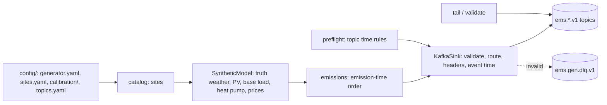

# 13 · Subsystem: ingest (data generators → Kafka)

## Current consensus

`ems-gen` (`src/ems/ingest/`) streams contract events (`08-contracts.md`) for Polish sites to Kafka. External
data reaches the EMS only through these topics (ADR 0011). Built: synthetic data for EMS-managed households (spec 001) and
live sources, record/replay and hybrid mode (spec 002), scale, background batteries and faults (spec
003), other assets, site types and a 3-broker profile (spec 004).

### Layout

| Module | Role |
|---|---|
| `contracts/` | envelope and payload models, ids, time, topic plans and routing, schema export (importable by actors) |
| `ingest/catalog/` | site models, voivodeship table, deterministic catalog, `config/sites.yaml` overrides |
| `ingest/rng.py` | counter-based randomness keyed by (seed, location, variable, step) |
| `ingest/synthetic/` | `solar` (pvlib SPA numpy + Ineichen), `weather` (truth and forecasts), `pv`, `load` (BDEW H25/G25), `heat_pump`, `balance`, `prices` |
| `ingest/generator.py` | chunks, event builders, emission schedule |
| `ingest/runner.py` | preflight, pacing per clock mode, run manifest |
| `ingest/kafka/` | client config, admin (ensure), sink, preflight |
| `ingest/tools/` | bounded topic reader, validate |

### Synthetic models (calibration in `config/calibration/*.yaml`)

- **Determinism**: every value is a function of (seed, location, variable, quarter index). Hash-based uniforms
  make a location's output independent of batch size and order (AC-001-26, bit-exact); AR(1) noise is a per-row
  recursion with a 6-time-constant burn-in, so values barely depend on the window start.
- **Weather truth**: a national hourly regime chain (clear / broken / overcast, monthly probabilities) shared by
  all sites, plus regional and local AR noise, gives the clear-sky index; GHI = Ineichen clear-sky × index
  (≤ 1.1 × clear-sky); Erbs split into DNI/DHI. Temperature: seasonal and diurnal harmonics, continentality,
  lapse rate, national synoptic and local anomalies. Wind: Gaussian AR copula (national share 0.8) → Weibull at
  10 m, power-law shear to 100/120 m, direction as a mean-reverting walk.
- **Forecasts**: runs every 3 h, 192 steps, emitted 90 min after issue; errors correlated across steps, spread
  growing with lead time; clipped to physical bounds.
- **PV**: pvlib Hay-Davies POA, Faiman cell temperature, PVWatts DC (`effective_irradiance=`) and inverter
  clipping at the AC rating, seasonal soiling/snow derate. One simulated year for the test site: 932 kWh/kWp
  (PVGIS central Poland about 930; measured PL rooftops 869–1076).
- **Base load**: demandlib 0.2.2 BDEW 2025 H25 (G11/G12) and G25 (C11/C21) on a tz-aware Europe/Warsaw index
  with Polish holidays, renormalised to an exact annual sum, mean-one lognormal daily and interval noise. Official
  Polish DSO profiles exist only as yearly PDF annexes in each DSO's IRiESD with no reuse terms, so BDEW is the
  default (spec 002 may add a loader for user-supplied DSO files).
- **Heat pump**: degree-hour space heating (base 15 °C, heating curve) and hot water over a Carnot-fraction COP;
  the test site uses about 3.7 MWh/yr.
- **Prices (PL_RCE-like)**: monthly base, daily shape with morning and evening peaks, weekend/holiday factor,
  national PV index dip (negative middays in spring/summer), wind index, AR noise and rare evening spikes; one
  simulated year gives 3.3 % negative quarter-hours. Published D−1 13:00–16:15 local (77 % 13–14 h).
- **Batteries**: sites declare `bess.control: ems | site`. EMS-managed sites (incl. the test site) emit no
  battery or grid measurements (ADR 0014); unmanaged sites emit grid import/export closing the balance.

### Clock modes

`backfill` (as fast as possible; simulated time only), `accelerated` (`--speed`, default 96), `realtime` (start
now, wall-clock pacing). Wall time is used only for pacing and `ingested_at`.

### Facts owned (single writer)

`ems-gen` is the only writer of the external inputs: weather forecasts, metered production/consumption of
uncontrolled assets, and prices. These rows move into `01-architecture.md` when the actor spec writes it.

### Live sources, routing, record and replay (spec 002)

- **Mapping engine** (`ingest/mapping/engine.py`, `mappings/*.yaml`, schema `mappings/_schema/`): raw payload →
  canonical rows (rows or column layouts, dotted paths or JSON pointers whose segments may contain dots,
  time zones and labels, units, transforms, sign split, null policy, quality map). Adapters build events from rows.
- **PSE** (`live/pse.py`; `pse.rce.v2`, `pse.csdac.v2`): one event per report and business day once every
  local-day slot is there; `issued_at` = PSE publication time (revisions → new events); `nextLink` paging;
  polls D+1 13:00–18:00 local every 15 min, then hourly, and re-polls D for revisions.
- **Open-Meteo** (`live/openmeteo.py`; `openmeteo.forecast.v1`): explicit model per site (ICON-D2 inside
  43.18–58.08 N / 3.94 W–20.34 E, DMI HARMONIE elsewhere), run time from `/data/<model>/static/meta.json`
  (used ≥ 10 min after availability), run-anchored 192-step window, truncated before the first step with a
  missing value; free API by default, customer API with the key in an `X-Api-Key` header.
- **ENTSO-E A44** (`live/entsoe.py`; off until `EMS_ENTSOE_TOKEN` and `live.entsoe.enabled`): hardened lxml
  parsing by local name, contract type A01, A03 forward-fill to the period end, native resolution (PT60M before
  2025-10-01), identical duplicate series collapse, conflicting ones are logged and not emitted, token in the
  `SECURITY_TOKEN` header, 10-minute back-off on 429. Run against the real API on 2026-10-29
  (<https://web-api.tp.entsoe.eu/api>, document type A44, zone `10YPL-AREA-----S`): token and header accepted;
  2025-09-30 returned `PT1H` × 24 slots in EUR, 2025-10-26 returned `PT15M` × 100 slots, and the current and next
  delivery day returned `PT15M` × 96 slots (tomorrow was already published in the early afternoon). A recording of
  these responses (`make record`, raw XML in `data/recordings/<name>/raw/entsoe/`, never commit it) resolved the
  VERIFY items: schema version 7:3, a single `TimeSeries` with the same elements and order as the hand-written
  fixtures, `curveType` A03 with all 96 positions present (so the forward-fill path is exercised by fixtures
  only), `createdDateTime` equal to the request time (no publication time, as risk L4 assumed). The EUR prices
  match PSE's `csdac-pln` slot for slot with a constant PLN/EUR ratio (≈ 4.4 on 2026-10-29 and 2026-10-30).
- **HTTP** (`live/http.py`): retries with jitter on 429/5xx/timeouts only; secrets scrubbed from URLs, errors
  and recordings.
- **Router and hybrid** (`sources/router.py`, `sources/live_runner.py`, `runner.run_hybrid`): per-stream modes
  from the generator config; live weather for `live.locations`, synthetic for the rest, one price source. A live
  site's synthetic PV and heat pump follow its latest live forecast step for each interval.
  `config/generator.live.yaml` + `make gen-live` run it.
- **Record and replay** (`sources/recording.py`): `ems-gen record --name N` stores raw responses (redacted),
  events (`events.jsonl`) and a manifest in `data/recordings/N/`; `ems-gen replay --name N` re-publishes them
  with their ids, marked `replay:<source>`.
- **Calibration** (`ingest/calibration.py`, `jobs/calibrate.py`): price and temperature fits → candidate files in
  `config/calibration/candidates/` (review before adopting). Example: ERA5 2024 at Poznań gives an annual mean of
  11.5 °C (a record-warm year; the default 8.7 °C is the 1991–2020 normal).

Attribution: Open-Meteo data is CC BY 4.0 (NOTICE next to fixtures; "Weather data by Open-Meteo.com"); ENTSO-E
day-ahead prices are not open data, so only hand-written fixtures are committed; PSE data is kept only as a few
test fixtures.

### Scale, background batteries, faults, stats (spec 003)

- **Fleets**: `scale.synthetic_locations` sites, processed in slices of `scale.site_chunk` (default 2,000);
  slicing never changes a value (row-wise maths). Batteries and cumulative registers carry their state
  across consecutive chunks of a run.
- **Background batteries**: `scale.site_controlled_bess_share` of generated batteries are `control: site`
  (a separate hash decides, so the share never changes other catalog draws). Their rule policy (PV surplus,
  cheapest 4 night slots, evening 17–21 local and top-10 % prices) drives the pure domain battery
  (`src/ems/domain/battery.py`); events carry `bess` charge (consumption), discharge (production), an instant
  SoC reading (quantity `soc`, direction `charge`) and grid flows that close the balance.
- **Faults** (`ingest/faults.py`, `faults:` in `generator.yaml`, `ems-gen run --faults`): missing, duplicate
  (identical event twice), late (up to `late_max`, same event time and id), stuck values, register resets
  (with `meters.emit_registers`), estimated/substituted flags; each decision is a keyed uniform of (seed,
  event id, kind), so runs are reproducible.
- **Stats** (`ems-gen stats`, `make stats`): per topic and key: count, partitions, event-time range, gaps
  (interior missing quarter-hours), duplicate ids, late arrivals (after a newer interval of the same key).
- **Benchmark** (`make bench`, `jobs/benchmark.py`; results in `experiments/results/benchmark-*/results.json`).
  2026-10-20 on the author's Mac (arm64, 10 CPUs), one simulated day:

  | Sites | Arrays | Events built + serialised | Payload | Kafka produce (1,000 sites) |
  |---|---|---|---|---|
  | 1,000 | 0.8 s | 174,562 in 14 s (12k/s) | 623 MB | 171,202 events in 35 s (4.9k/s), 0 failures |
  | 10,000 | 3.0 s | 1.74 M in 199 s (8.7k/s) | 6.2 GB | — |

  Per-event object building and validation dominate, not the models; forecasts are ~70 % of the bytes.
  Rerun 2026-10-20 after spec 004 (households with EVs; `benchmark-20261020T204019Z`): 1,000 sites 174,562
  events in 15.0 s, 627 MB; 10,000 sites 1.74 M in 210 s, 6.3 GB; produce 171,202 in 33 s (5.2k/s), 0 failures.

### Other assets and site types (spec 004)

- **Site types** (`catalog/build.py`): `scale.site_mix` gives shares of `household`, `commercial`,
  `industrial`, `wind_farm`, `solar_farm`, `biogas_plant`, `hydro_plant`; empty means households only. The
  type comes from its own hash of (catalog seed, location), and household EVs (20 %, overnight 3.7–11 kW) from
  another, so households keep all earlier draws. Plant sites are background sites (never EMS-managed); their
  region follows the voivodeship wind/PV weights (hydro: the southern voivodeships). Commercial sites get C11
  or C21 (the 40 kW / 63 A rule), PV and daytime 22 kW chargers; industrial sites a CHP (C21).
- **Wind** (`synthetic/wind.py`): vendored curves `config/turbines/power_curves.csv` (5 types from
  windpowerlib's data, ODbL, NOTICE), `np.interp` with zero below cut-in and above cut-out, IEC density
  correction `v·(ρ/1.225)^(1/3)` with ρ from pvlib `alt2pres` and the hub temperature, power-law shear from
  10 m (`wind.shear_alpha.wind_farm` 0.14). Catalog hub heights are Polish-typical (105–137 m), not the CSV's.
  A Pomeranian farm over 2025 gives capacity factors 19–30 % by type, mean ≈ 25 % (2025 PL onshore ≈ 24–25 %).
- **CHP**: heat-led (`heat_kw_per_k · max(0, 15 − T) + heat_base_kw`, 85 % on weekends), electric = heat ×
  power-to-heat, off below `min_load`, capped at rating; emits `heat_energy` beside `active_energy`.
- **Biogas**: ≈ 93 % level with slow AR noise, capacity factor 80–95 % after outages.
- **Biomass**: follows the price (min load at ≤ 100 PLN/MWh, rated at ≥ 700), ramp-limited per interval; the
  level carries across chunks (a function of each interval's price, so chunking never changes a value).
- **Hydro** (run-of-river): seasonal flow (spring peak mid-April, low late August) × lognormal AR noise.
- **Outages** (`synthetic/outages.py`): whole days, keyed per (seed, site, kind, day): forced 2 % of days for
  wind, 0.5–1 % for plants, plus one planned block a year (14 days thermal, 7 days hydro).
- **EV** (`synthetic/ev.py`): one session per site and local day (overnight 18:30 → 07:00, daytime 08:30 →
  16:30, normal jitter), charging at the charger limit from arrival until the lognormal need is met or the car
  leaves.
- Production events carry `wind`, `chp` (energy and heat), `biogas`, `biomass`, `hydro`; consumption events
  `ev_charger`. Grid flows of unmanaged sites include every asset. A mixed 1,000-site day builds in ≈ 13 s.

### 3-broker profile (spec 004)

`docker compose --profile cluster` (`make cluster-up` / `cluster-down`): one KRaft controller (`kafka-ctl`)
and brokers `kafka-1..3` on 127.0.0.1:19092–19094, no volumes; topics via `topics ensure --profile cluster`
(RF 3, min ISR 2). Integration test: one broker stopped → writes succeed; two stopped → `NOT_ENOUGH_REPLICAS`.
The controller is separate (the plan said combined nodes) because with combined nodes two stopped nodes also
lose the quorum, so the ISR never shrinks and writes only time out.

### How to add an asset model

Add parameters to `catalog/sites.py` (new `kind`), a vectorised function in `synthetic/` returning
`[n_loc, n_steps]` kWh from the truth arrays, a builder line in `generator._meter_builders` (production or
consumption by direction; generation kinds go in `PLANT_KINDS` so grid flows include them), and property
tests for bounds and balance.

## What to build

- Ingestion spec (Plan 2): consume these topics into Restate.
- Later, if needed: weather-cell keyed forecasts (G6), DSO standard profiles for C-tariff shapes.

## Prerequisites

- `make up` (Kafka stack).

## Open questions

- VERIFY: voivodeship bounding boxes are approximate (0.1°); refine from the GUGiK PRG register if spatial
  precision matters.
- Faker output can change with its version (pinned 40.40.0; golden catalog test).
