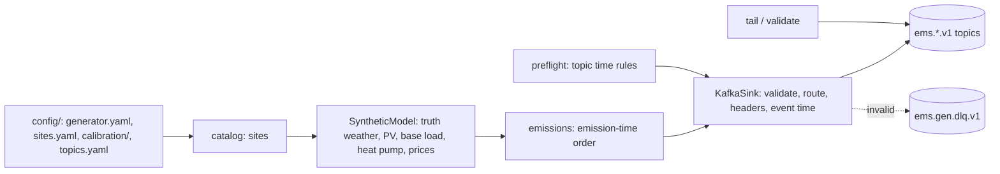

# 13 · Subsystem: ingest (data generators → Kafka)

## Current consensus

`ems-gen` (`src/ems/ingest/`) streams contract events (`08-contracts.md`) for Polish sites to Kafka. External
data reaches the EMS only through these topics (ADR 0011). Built in spec 001: synthetic data for EMS-managed
households; specs 002–004 add live sources, scale, faults and more assets.

### Layout

| Module | Role |
|---|---|
| `contracts/` | envelope and payload models, ids, time, topic plans and routing, schema export (importable by actors) |
| `ingest/catalog/` | site models, voivodeship table, deterministic catalog, `config/sites.yaml` overrides |
| `ingest/rng.py` | counter-based randomness keyed by (seed, location, variable, step) |
| `ingest/synthetic/` | `solar` (pvlib SPA numpy + Ineichen), `weather` (truth and forecasts), `pv`, `load` (BDEW H25/G25), `heat_pump`, `balance`, `prices` |
| `ingest/generator.py` | chunks, event builders, emission schedule |
| `ingest/runner.py` | preflight, pacing per clock mode, run manifest |
| `ingest/kafka/` | client config, admin (ensure), sink, preflight |
| `ingest/tools/` | bounded topic reader, validate |

### Synthetic models (calibration in `config/calibration/*.yaml`)

- **Determinism**: every value is a function of (seed, location, variable, quarter index). Hash-based uniforms
  make a location's output independent of batch size and order (AC-001-26, bit-exact); AR(1) noise is a per-row
  recursion with a 6-time-constant burn-in, so values barely depend on the window start.
- **Weather truth**: a national hourly regime chain (clear / broken / overcast, monthly probabilities) shared by
  all sites, plus regional and local AR noise, gives the clear-sky index; GHI = Ineichen clear-sky × index
  (≤ 1.1 × clear-sky); Erbs split into DNI/DHI. Temperature: seasonal and diurnal harmonics, continentality,
  lapse rate, national synoptic and local anomalies. Wind: Gaussian AR copula (national share 0.8) → Weibull at
  10 m, power-law shear to 100/120 m, direction as a mean-reverting walk.
- **Forecasts**: runs every 3 h, 192 steps, emitted 90 min after issue; errors correlated across steps, spread
  growing with lead time; clipped to physical bounds.
- **PV**: pvlib Hay-Davies POA, Faiman cell temperature, PVWatts DC (`effective_irradiance=`) and inverter
  clipping at the AC rating, seasonal soiling/snow derate. One simulated year for the test site: 932 kWh/kWp
  (PVGIS central Poland about 930; measured PL rooftops 869–1076).
- **Base load**: demandlib 0.2.2 BDEW 2025 H25 (G11/G12) and G25 (C11/C21) on a tz-aware Europe/Warsaw index
  with Polish holidays, renormalised to an exact annual sum, mean-one lognormal daily and interval noise. Official
  Polish DSO profiles exist only as yearly PDF annexes in each DSO's IRiESD with no reuse terms, so BDEW is the
  default (spec 002 may add a loader for user-supplied DSO files).
- **Heat pump**: degree-hour space heating (base 15 °C, heating curve) and hot water over a Carnot-fraction COP;
  the test site uses about 3.7 MWh/yr.
- **Prices (PL_RCE-like)**: monthly base, daily shape with morning and evening peaks, weekend/holiday factor,
  national PV index dip (negative middays in spring/summer), wind index, AR noise and rare evening spikes; one
  simulated year gives 3.3 % negative quarter-hours. Published D−1 13:00–16:15 local (77 % 13–14 h).
- **Batteries**: sites declare `bess.control: ems | site`. EMS-managed sites (incl. the test site) emit no
  battery or grid measurements (ADR 0014); unmanaged sites emit grid import/export closing the balance.

### Clock modes

`backfill` (as fast as possible; simulated time only), `accelerated` (`--speed`, default 96), `realtime` (start
now, wall-clock pacing). Wall time is used only for pacing and `ingested_at`.

### Facts owned (single writer)

`ems-gen` is the only writer of the external inputs: weather forecasts, metered production/consumption of
uncontrolled assets, and prices. These rows move into `01-architecture.md` when the actor spec writes it.

### How to add an asset model

Add parameters to `catalog/sites.py` (new `kind`), a vectorised function in `synthetic/` returning
`[n_loc, n_steps]` kWh from the truth arrays, a builder line in `generator._meter_builders` (production or
consumption by direction), and property tests for bounds and balance.

## What to build

- Spec 002: mapping engine, Open-Meteo, PSE RCE and csdac adapters, ENTSO-E (flag), record/replay, hybrid mode,
  calibration job.
- Spec 003: many locations, unmanaged sites with BESS, fault injection, stats, benchmark.
- Spec 004: wind, CHP, biogas, biomass, hydro, EV, farm and plant site types; 3-broker profile.

## Prerequisites

- `make up` (Kafka stack).

## Open questions

- VERIFY: voivodeship bounding boxes are approximate (0.1°); refine from the GUGiK PRG register if spatial
  precision matters.
- Faker output can change with its version (pinned 40.40.0; golden catalog test).
